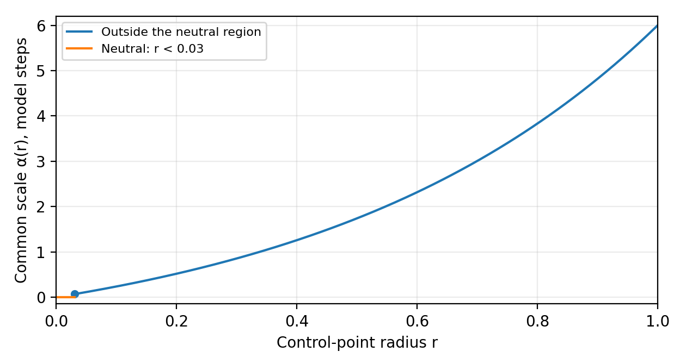
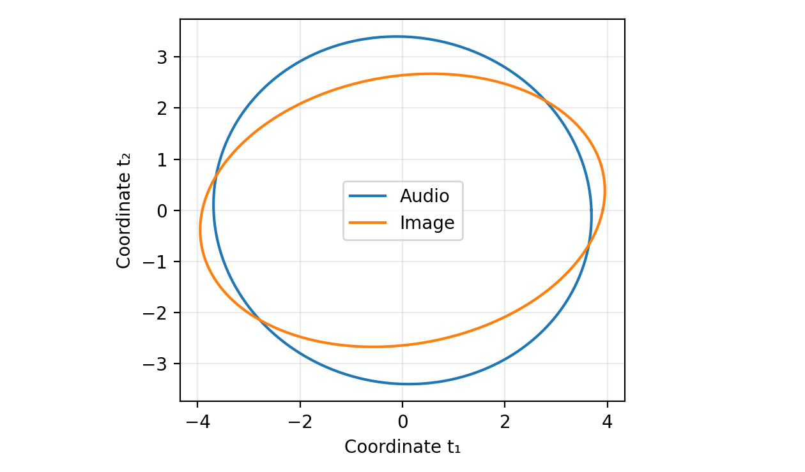
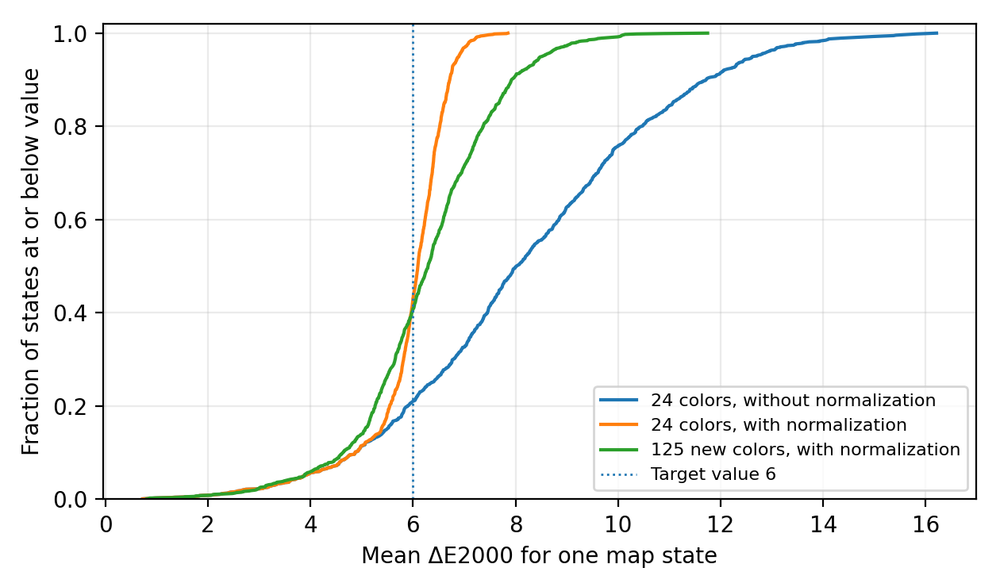
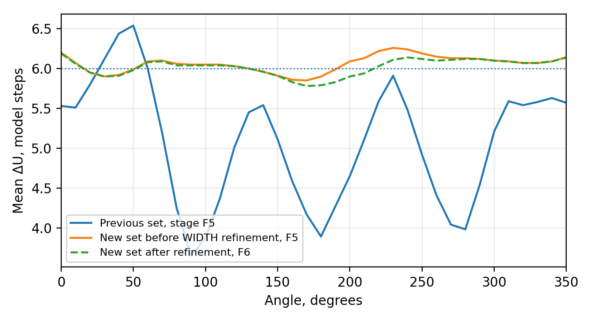

SHIKARDOS ORBITAL

Model-Calibrated Radial Control of Audio and Image Processing Parameters

Mathematical Structure, Reachability, and Computational Verification

Research manuscript with a dissertation-style structure

Concept originator: Yuri Georgievich Gazhiu

Revision 2.1 · 17 October 2026

# Manuscript information

This work presents a complete account of a theoretical and computational study of a specific implementation of SHIKARDOS ORBITAL. It has been prepared for the author's approval, technical review, and subsequent publication. This document is not a university-accepted dissertation, evidence of an awarded degree, or confirmation of worldwide priority. The author's full name was approved by the author on 17 October 2026. The publication's authorship and the contributors' roles must be agreed before public release. No university, academic supervisor, or defense information is given because the supplied materials provide none.

The study is based on the package “2026-10-16 ORBITAL для Ориона” supplied by the project's concept originator and on the previously supplied web implementation of the control scheme. The package contains source code, calibration programs, saved results, and an engineering description prepared by Eliar. The text distinguishes developer reports, directly repeated computations, and analytical consequences. Use of the project's terms “law,” “kinship,” “ear measure,” and “transfer curve” does not imply recognition of a new physical law or a clinically validated model of perception.

The concept is Yuri Georgievich Gazhiu's; engineering implementation and code description are attributed to Eliar (Claude AI, Anthropic); preparation of the text, mathematical exposition, and programmatic checks is attributed to Orion (ChatGPT, OpenAI), in dialogue with Yuri. This is a disclosure of human and AI roles, not a list of scholarly coauthors or a claim of employment by the named organizations. Correspondence and cross-checking between AI systems do not constitute external laboratory peer review. Yuri must approve the text and accept responsibility for the published claims.

The v1 computational package contains the source text of the first edition, computational programs, and logs. It does not include the calibration corpus's music, private conversations, passwords, or ABX keys. Availability of the computational code does not automatically grant a license to the entire player or to third-party music recordings. The v2.1 document package for GitHub contains the Russian edition and its full English translation, figures, a change log, and the editorial-correction check; it does not replace or modify the v1 computational package.

In this second edition, the classification of the audio corpus is corrected against `etalon/sostav.json`, the origin of the concept is added, and Eliar's role as an AI system is disclosed explicitly. The formulas, numerical tables, and conclusions of v1 are retained. Their computational runs belong to the preparation of v1 on 16 October 2026; they are not represented as having been rerun during this editorial update. Eliar's reported cross-check has the status of a communication from a development participant [S13], not an external independent replication. The English text is a full translation of this Russian edition, not a separate study.

# Abstract — translated from the Russian original

A radial mapping from a two-dimensional control domain to a coupled set of audio and image processing parameters is studied. In the SHIKARDOS ORBITAL implementation, the point's position determines signed cosine responses of the poles. Their common scale is limited using a quadratic form of the “kinship” matrix, followed by a nonlinear radial function and individual asymmetric piecewise-linear transfer curves. In the supplied procedure, the audio curves and couplings are constructed from changes in model auditory features over reference signals; the image curves are based on mean CIEDE2000 over 24 fixed colors, while the couplings are derived from CIELAB displacement directions.

An exact two-dimensional equivalent of the common normalization is derived for a fixed set of bilateral poles. The analysis establishes a bound on the joint magnitude of control steps, the elliptical geometry of reachable states, analytical parameter limits, conditions for inverse recovery of coordinates, and non-identifiability of the full matrix from a single fixed map. The central neutral region is shown to create a discontinuity in the original static mapping, and depth scaling after the nonlinear transfer curve is shown to fall outside the proven normalization guarantee.

The computational work includes source-constant checks, an image-calculation replay, and comparisons of equivalent implementations over 152,640 configurations. The CIEDE2000 implementation is checked against 34 reference pairs published by its implementation-note authors. In the repeated image experiment over 1,120 configurations, the mean change decreases from 8.198 to 5.907 CIEDE2000 units against a target of 6. A separate check on 125 synthetic colors yields a mean of 6.269 and a maximum of 11.745: uniformity on the calibration set does not provide a universal upper bound. A difference is identified between the scalar audio measure and the norm of its vector representation when features are missing. Archived audio results are separated by measure version and are not represented as a repeated audio experiment.

The work establishes properties of a specific algorithm and conditions for its verification. Benefits for human perception, adjustment usability, actual execution time, or arbitrary physical processes were not confirmed by this study.

**Keywords:** multiparameter control; radial interface; Gram matrix; calibration; digital audio processing; color adjustment; CIEDE2000; reachability; reproducibility.

# Abstract — English abstract retained from v1

**Model-calibrated radial control of audio and image processing parameters: mathematical structure, reachability, and computational verification.**

This manuscript studies a two-dimensional radial control map implemented in SHIKARDOS ORBITAL. Signed pole projections are jointly normalized using a quadratic form and converted into processing parameters through asymmetric piecewise-linear transfer functions. Audio calibration uses a project-specific auditory-feature dissimilarity model; image calibration uses mean CIEDE2000 over 24 fixed colors, with coupling coefficients derived from CIELAB displacement fields.

An exact two-dimensional representation is derived for fixed bilateral poles. The analysis establishes a bound on the quadratic magnitude of control steps, an elliptical reachable set, coordinate-wise extrema, conditional inverse recovery, and non-identifiability of the full coupling matrix from one fixed configuration. A discontinuity at the neutral-zone boundary and limitations of post-transfer depth scaling are stated explicitly.

The computational study includes source-constant checks, 34 CIEDE2000 reference pairs, an image-calibration replay, and 152,640 comparisons between equivalent implementations. Over 1,120 image-control configurations, normalization reduces the mean calibration-set difference from 8.198 to 5.907 against a target of 6. An additional test on 125 synthetic colors yields a mean of 6.269 and a maximum of 11.745, exposing a limitation of calibration-set generalization. A synthetic feature test also reveals that the audio scalar dissimilarity and its vector norm differ when some features are unavailable. Archived audio results are separated by model version and are not reported as newly reproduced audio measurements.

The findings concern a specified control algorithm. Human perceptual benefits, interaction efficiency, universal novelty, and full Android runtime behavior remain unestablished. No participant study was conducted.

# Contents

- [1. Introduction and research problem](#part-01)
- [2. Previous methods and the position of ORBITAL](#part-02)
- [3. Materials, versions, and verification method](#part-03)
- [4. Calibration of audio directions](#part-04)
- [5. Calibration of image parameters](#part-05)
- [6. Formal model and principal properties](#part-06)
- [7. Reachability, invertibility, and geometric limitations](#part-07)
- [8. Repeated computational experiments](#part-08)
- [9. Archived audio results and version differences](#part-09)
- [10. Implementation, state, and limits of model guarantees](#part-10)
- [11. Scientific contribution and further verification](#part-11)
- [Conclusion](#part-12)
- [References and data sources](#part-13)
- [Appendix A. Source identification](#part-14)
- [Appendix B. Kinship tables](#part-15)
- [Appendix C. Reproducing the available part](#part-16)

<a id="part-01"></a>

# 1. Introduction and research problem

## 1.1. Practical task

Audio and image adjustment typically involves several controllable quantities. In SHIKARDOS, these include gains in frequency regions, stereo width, brightness, contrast, and saturation. Independent controls provide access to individual coordinates, but do not prescribe a convenient pattern of joint change. A radial interface offers a different representation: the user moves one point and the program computes a coupled parameter vector. The existence of this class of interface is established by earlier studies [R1, R2]; replacing several knobs with one point is not, by itself, treated as evidence of novelty.

The subject of this work is not the geometry of the drawing, but the specific ORBITAL calculation chain. Its investigated elements are signed pole directions, a matrix of couplings between them, joint limiting in step space, and separate transfer curves that convert steps into different physical or software units. The code uses a common framework for audio and images, but the domain-specific sets, coefficients, and scales differ [S2–S5].

The testable question is as follows: which properties does this map guarantee by definition, which parameters can actually be reproduced from the calibration procedure, and how closely does joint normalization bring the model change to a specified level on the available test data? This formulation permits positive and negative results without presupposing superiority over every alternative.

## 1.2. Object, subject, and objective

The object of study is software control of coupled processing parameters. The subject is the radial map, its calibration, and its numerical implementation in the supplied source snapshot. The objective is an independently checkable specification: to trace the coefficients' provenance, derive reachable states and limits, repeat the available computations, and establish limits of generalization.

The tasks are addressed sequentially: versions and input materials are identified; the audio and color procedures are described; a formal model is constructed; its properties are proved; the software is cross-checked; persistence of the image results outside the calibration set is tested; and the saved audio logs are analyzed separately. Missing audio recordings are not replaced with other signals under the guise of repeating the original experiment.

## 1.3. Results submitted for scientific discussion

The first result is an exact representation of the kinship matrix's influence by a two-dimensional matrix for fixed bilateral-pole geometry. The second is a description of this map's reachability, extrema, and invertibility. The third is a reproducible cross-check of calibration data against source constants and verification of the color computation. The fourth comprises established limitations: matrix non-identifiability in one configuration, the neutral-region discontinuity, disagreement of scalar and vector audio measures with missing features, and larger upper color deviations on an additional set.

These results constitute the present analysis. The tools of linear algebra, interpolation, and numerical checking used here are established. This work does not separately prove that this combination or each of its consequences is the first such result in the world literature. The publication's contribution should be assessed through its specification, checks, and established limitations, rather than an unsupported priority claim.

## 1.4. Limits of the claims

The work does not prove physical primacy of five colors or five notes. The code's five audio poles denote processing directions; WIDTH is not a frequency band. There are six image-parameter poles. The mathematical conclusions do not require a spectral correspondence between color and musical sound [S3, S4]. Historical and philosophical motivations for the concept are not used in the proofs.

Nor does the work claim constant perceived loudness, freedom from overload for every signal, bit-for-bit preservation of the entire chain at the center, or reduced adjustment time for a user. Each claim would require its own experiment. The number of computational configurations is distinguished from the number of participants: there were no participants in the checks performed.

## 1.5. Origin of the concept

This section records motivation and the project's internal chronology, not proof of mathematical statements or worldwide priority. The project document “ФУНДАМЕНТ — SHIKARDOS ACCORD,” dated 30 September 2026, sets out the concept of Yuri Georgievich Gazhiu: a circle, poles movable around its circumference, and a main control point inside. Movement direction determines the character of joint change, while distance from the center determines its magnitude. The document quotes Yuri as saying, in English translation: “The parameters are linked to one another in a geometric progression” [S12].

| Date | Milestone and source |
|---|---|
| 30 September 2026 | Conceptual foundation: circle, poles, main point, and a geometric-progression relationship between parameters. Recorded in the project document [S12]. |
| 3 October 2026 | Audio-map study; cloud snapshot `0827015c`, branch `claude/pensive-knuth-1muz7p` [S1, S9]. |
| 8–10 October 2026 | Changes to the core and deployed player sets reported in the engineering description: `akkord.dart`, `polyusa_zvuka.dart`, `akkord_kartinki.dart`, and Orbital state. This is not the initial creation date of every file: the same description dates `akkord_linejka.dart` to 30 September [S1]. |
| 16 October 2026 | Beta 1.2.4, build 797, commit `b9648a3a`; the engineering description states that its investigated ORBITAL files match player snapshot `14cb8a91` [S1, S13]. |

This chronology distinguishes the originating concept, model-based study, and deployment in the player. The dates and commit relationships are based on the supplied project materials and Eliar's clarification; the remote Git history and the public distribution of each version were not independently verified. The chronology does not establish priority over other authors. The specific formulas and coefficients are justified below through the specification, calibration programs, and checks, rather than the date or authority of the originating statement.

<a id="part-02"></a>

# 2. Previous methods and the position of ORBITAL

## 2.1. Spatial control of musical parameters

Momeni and Wessel investigated geometric organization of musical material, processing parameters, and higher-level musical structures [R1]. Their work is important as a documented example of spatial audio control preceding ORBITAL. It rules out the broad novelty claim that “multiple audio parameters are controlled by geometric position for the first time.” Membership in the same general field does not, however, establish identity of the particular computational maps.

Bencina's Metasurface arranges parameter snapshots on a plane and interpolates them using natural neighbors based on a Voronoi partition; its implementation in AudioMulch is described [R2]. An important distinction from the investigated ORBITAL is that a Metasurface anchor represents a parameter set, whereas an ORBITAL pole defines a directional influence that can be positive or negative. A valid comparison must therefore consider anchor semantics and reachable states, not only cursor appearance.

A user comparison cannot be made fair merely by giving the approaches the same screen size. Comparable reachable result ranges must be provided, or targets reachable by both methods must be selected. Otherwise, a search-time difference may reflect the fact that one interface does not contain the required state at all. This is a methodological consequence of the problem formulation, not a result of a conducted user study.

## 2.2. Normalization of coupled effects

Fink, Holters, and Zölzer examine correlation-dependent weight matching in cross-fading and dry–wet mixing [R3]. Accounting for cross terms relates the weights to the power of the resulting signal mixture. This provides related mathematical context for quadratic normalization, but the objects are not identical: ORBITAL normalizes control steps derived from model fields rather than directly summing audio signals with measured correlation.

Consequently, similarity in the form of the quadratic expression does not itself establish borrowing or complete method identity. Nor does it permit the quadratic form to be declared a new mathematical tool. The research problem is to justify the particular connection between the change model and the control parameters.

## 2.3. Adaptive selection of visual alternatives

Koyama and colleagues' Sequential Line Search converts a multidimensional visual-choice task into a sequence of one-dimensional slider queries using Bayesian optimization and participant preferences. Its demonstrations include photographic color enhancement and material parameters [R4]. It is a predecessor of the sequential selection and refinement mode discussed for SHIKARDOS.

The investigated code contains no such adaptive optimizer. ORBITAL specifies a fixed map for fixed poles, whereas Sequential Line Search successively selects new search directions. A future navigation mode is not included among this work's results. Nor is it claimed that a single slider pass examines all independent parameter combinations.

## 2.4. Dissimilarity measures and their scope

CIEDE2000 is used for images; its software implementation is checked against the supplementary data of Sharma, Wu, and Dalal [R5]. This is an external arithmetic check of color difference, not confirmation that a mean over 24 colors accurately predicts human preference for any photograph.

The audio model uses ERB bands and threshold-like scales, with comments referring in particular to auditory filters and literature estimates of discriminability [S6]. Glasberg and Moore's work concerns derivation of auditory filter shapes [R6]. It does not validate the complete project-specific ΔU measure. Similarly, reference to BS.1770 concerns a method for measuring loudness and true peak, not certification that the entire implementation complies with that recommendation. For reproducibility, the historical BS.1770-4 version used in the code description is fixed here [R7].

## 2.5. Implication for the research formulation

On the basis of the reviewed sources, ORBITAL should be presented as a specific model-calibrated radial scheme within the established field of low-dimensional control. Previous methods define necessary points of comparison. The originality of the calibration procedure and practical significance of its combination should be assessed after precise reproduction and comparison, not inferred from the absence of an identical name.

This review is limited to directly relevant primary sources. It does not replace a complete patent search, a review of all closed laboratory work, or a systematic meta-analysis of interfaces.

<a id="part-03"></a>

# 3. Materials, versions, and verification method

## 3.1. Research corpus

The principal archive is 199,154 bytes and contains 69 files. ZIP structure and CRC checks identified no corruption. Its SHA-256 is given in Appendix A. The contents include four principal Dart files, associated state and depth components, an image-calibration program, the audio study with programs and JSON results, tests, and excerpts on smoothing [S1].

The accompanying description associates the player code with commit `14cb8a91` and the cloud study with `0827015c`. The developer associates the same ORBITAL files with beta 1.2.4, build 797. This Git-provenance information comes from the package: the remote repository and commit chain were not directly checked in this study. The APK supplied earlier belongs to build 784; it must not be presented as a tested build 797.

The package does not contain the complete native DSP engine or the complete audio corpus. According to `etalon/sostav.json`, the corpus comprises 32 items: 9 synthetic signals, 3 Oboe music recordings (`song1`, `song2`, `song3`), and 20 songs from the project author. Thus there are 23 music recordings and 9 synthetic signals. The three Oboe recordings originate in `third_party/oboe`; Apache-2.0 is identified in the package description and the `etalon.py` comment [S1, S10]. This corrects the v1 classification, which incorrectly included the Oboe recordings among synthetic signals. The audio files themselves and their licenses were not re-examined and were not added to the document package. Missing music and the source dependencies referenced by the test-harness build prevent a replay of the audio study from input samples through final metrics. Source code for individual functions and saved JSON files do not substitute for that replay.

## 3.2. Evidence levels

Four types of support are used below. S identifiers refer to supplied project materials: source code, descriptions, and archived results. V identifiers denote checks carried out in the preparation of v1 on 16 October 2026 and retained here without a new run. R identifiers refer to external primary publications and official documents. Statements accompanied by proofs are derived from the explicitly specified mathematical model.

A value reported in a saved audio-results file is called an archived result. Execution of a supplied calibration program to obtain a new number is called a repeated computation. Evaluation of a different input-color set is a separate new experiment, not a replay of the original. This citation scheme enables a reviewer to trace the origin of each numerical claim.

## 3.3. Operations performed (the v1 computational stage)

During preparation of v1, the core, signed transfer curves, both pole sets, state handling, ΔU functions, field and matrix construction, image-calibration program, research logs, and smoothing excerpts were read. The image computation was rerun, its rounded tables were compared with Dart constants, and the audio constants were checked against archived data. Dart tests are supplied in the archive but were not executed here: the Flutter/Dart environment and full project are absent.

An unchanged JavaScript module corresponding to the web representation of ORBITAL was taken from the preceding research version. Its constants were additionally compared with the newly received Dart files. Comparison with the factorized two-dimensional implementation, analytical-extremum checks, and inverse recovery were then rerun. This compares independent computational functions, not Android interface behavior [V1–V3].

The checks ran on Linux x86_64, Python 3.13.5, NumPy 2.3.5, and Node.js 22.16.0. The auditory-feature modules use SciPy. The investigated package's source code was not corrected; supplementary tests are stored separately. Full results include the environments, input configurations, and checksums.

## 3.4. Principles of numerical analysis

Real-arithmetic identities are not replaced by grid testing. Software agreement is assessed separately with a stated absolute tolerance. Tables distinguish original high precision from rounding for the application. The image experiment reports the mean, minimum, maximum, 95th percentile, and mean absolute error relative to the target 6. These are descriptive statistics of a deterministic sample, not confidence intervals for a human population.

Maps, angles, and colors within a computational experiment are dependent. Accordingly, 1,120 configurations must not be interpreted as 1,120 independent observers. Likewise, 152,640 computational inputs do not represent 152,640 independent tests of sound quality.

<a id="part-04"></a>

# 4. Calibration of audio directions

## 4.1. Poles and domain-specific transformations

The deployed audio set comprises five bilateral directions, all allowing positive and negative strength. Their order and home angles are listed in Table 1. Frequencies and scales come from `polyusa_zvuka.dart`; they are processing settings, not identified “fundamental notes” of nature [S3].

| Pole | Angle | Transformation of strength a at depth 1 |
|---|---:|---|
| BODY | 0° | Bell, 100 Hz, Q=1, gain 12a dB |
| AIR | 72° | High shelf, 6000 Hz, gain 12a dB |
| DENSITY | 144° | Two bells, 250 and 630 Hz, Q=1, each 9a dB |
| WIDTH | 216° | Multiplier 1+a for a≥0; 1+0.75a for a<0 |
| VOICE | 288° | Bell, 3000 Hz, Q=0.8, gain 9a dB |

Table 1. Audio set. Strength a is restricted to −1…1; WIDTH spans 0.25…2. Source: [S3].

Separate player processors, such as compression or reverberation, must not automatically be included in these five coordinates. The investigated map's neutral state eliminates its own contribution, but does not establish that every independent processor in the application is disabled.

## 4.2. The ΔU model

The project-specific dissimilarity measure between two versions of a signal is described in `uho.py`. Before comparison, loudness is matched using a calculation related to BS.1770; the original loudness change is retained separately. There are 40 ERB frequency bands from 50 to 16,000 Hz, with a 2,048-sample STFT window and a 480-sample hop at 48 kHz. Bands are grouped into eight groups for spatial features and three for envelopes [S6].

The thematic components are called “timbre,” “space,” “hall,” and “time.” They include changes in band excitation, interchannel correlation, interchannel level difference, decay rates, dynamic spread, envelope crest factors, and attack characteristics. The model's 80 and 60 dB SPL levels are assigned through an assumed correspondence to −23 LUFS; they are not a measured calibration of particular headphones or a room.

Several quantities are assigned a unit change, such as 1 dB for selected level components, log(1.1) for relative decay, and log(1.2) for attacks. The coefficient `FORMA=2.21` adjusts sensitivity to spectral shape. Comments associate its selection with a model reference bell of +1.5 dB at 1 kHz and state that listening confirmation is still absent [S6].

The source calls these scales units of a just-noticeable difference. This manuscript uses the narrower term **conventional step of the ΔU model**. Literature-based motivation for individual features does not establish that the full composite measure is uniform in discriminability across people, music genres, levels, and playback chains.

## 4.3. Individual transfer curves

For every pole, the original computation evaluates ΔU at strengths 1/8, 2/8, …, 8/8, separately in positive and negative directions. Each branch therefore has eight nodes. Before further processing, `osi.py` applies a cumulative maximum (`maximum.accumulate`) to the ΔU sequence to make the table nondecreasing. This is part of the procedure, not proof that the raw measurements are monotonic. The player stores the inverse relationship: the strength corresponding to a specified number of model steps. Linear interpolation is used between nodes, and strength is held at its limit beyond the final node [S2, S3, S7].

The positive and negative branches are not mirror images. For example, BODY reaches strength +1 at 6.806 steps and −1 at 4.462 steps. DENSITY's corresponding endpoints are 9.513 and 8.667; WIDTH's are 3.381 and 3.020. These differences reflect the chosen calibration computation, not universal psychoacoustic constants.

## 4.4. Change fields and the kinship matrix

For a pole, feature-change fields are obtained at approximately two steps in the positive and negative directions. Denote them by f⁺ and f⁻, and normalization of a nonzero vector by n(f)=f/||f||. According to `osi.py` and `proverka.py`, the bilateral direction is constructed as follows [S7, S8]:

$$
F_i=n\bigl(n(f_i^+)-n(f_i^-)\bigr),\qquad
\rho_{ij}=\langle F_i,F_j\rangle. \qquad (4.1)
$$

Under this definition, a negative coefficient means opposite orientation of two fields in the chosen feature space. The coefficient −0.658 for DENSITY and VOICE is a rounded inner product of the corresponding directions, not a subjective assessment of musical “incompatibility.”

The fields combine changes across the corpus. In the program, the scalar set score is the mean ΔU, whereas the combined vector field is formed by concatenation divided by the square root of the number of excerpts. Even when every individual vector norm equals its ΔU, the concatenation's norm equals the root-mean-square rather than the arithmetic mean. For values 1 and 3, these are √5 and 2, respectively. Field directions and scalar transfer curves are therefore connected through the procedure, but their norms are not identical by definition.

## 4.5. Corpus, computational chain, and reproducibility

The research description reports 32 reference signals and use of the actual player engine. The code clarifies the processing path: some purely tonal transformations use a faster SOS-filter route, whereas spatial and nonlinear cases use the engine test harness. The accompanying study reports a preliminary comparison of those routes [S7–S10]. Their audio equivalence was not repeated in the present study because the complete harness and input recordings are missing.

Three checks must therefore be distinguished. The first is an exact comparison of saved numbers against deployed tables; this was completed. The second is examination of the original calculation as a program and of its properties on controlled synthetic inputs; part of this was completed. The third is reprocessing the original corpus through the entire chain and reconstructing the matrix from scratch; this was not completed here.

Agreement between JSON and Dart alone does not certify the appropriateness of the auditory measure. It certifies that the stored results of the selected procedure were the values transferred into the code.

<a id="part-05"></a>

# 5. Calibration of image parameters

## 5.1. Input colors and processing function

The `linejki_kartinki.py` calibration program contains a fixed table of 24 eight-bit sRGB triples called ColorChecker. In this experiment, these are neither camera measurements of a physical chart nor material spectral data. The values are divided by 255 and used as input colors. The exact table is retained in the reproducibility package's source [S5].

The six controls are brightness, contrast, saturation, hue, warmth, and gamma. Brightness, hue, warmth, and gamma have neutral input 0 and range −1…1; contrast and saturation have neutral input 1 and range 0…2. Interface readouts range from −100 to 100.

The function `ruchki` first computes Y=0.2126R+0.7152G+0.0722B directly from the supplied components. Contrast, a brightness offset, and a power transform are applied to Y; color differences are retained insofar as the range permits. Saturation, rotation of color-difference components, and relative red–blue balance are then adjusted, after which values are clipped to 0…1. This describes the original code's order, not physically linear mixing of radiation.

CIELAB evaluation separately decodes sRGB, converts to XYZ, and normalizes to a white point. The internal Y in `ruchki` must therefore not be identified with the photometric luminance of already linearized light. The replay preserves the given order without “improving” substitutions [S5].

## 5.2. Scalar step and inverse transfer curve

For a vector of control readouts a, mean color difference over the source table is defined as:

$$
D_{24}(a)=\frac1{24}\sum_{k=1}^{24}
\Delta E_{00}\bigl(\operatorname{Lab}(c_k),
\operatorname{Lab}(T(c_k;a))\bigr). \qquad (5.1)
$$

One D₂₄ unit is called an image step in the project. Here it is a numerical unit of the adopted aggregate score, not an established visibility threshold for every pixel, display, or observer.

For an individual control, a 40-iteration binary search finds the readout corresponding to a requested number of steps. The table is constructed at intervals of 0.5 step up to 8, or until the control range saturates. When the limiting readout produces less than the requested difference, its actual endpoint is added. This accounts for the special final nodes for saturation and warmth. Positive and negative branches are computed separately [S5].

Binary search assumes that the relevant relationship is suitably monotonic over the selected range. The present check reproduces the computation on the data used; it does not prove monotonicity of any future processing formula or arbitrary corpus.

## 5.3. Kinship from CIELAB fields

An individual control's color field is computed at a positive effect of two steps. For each of the 24 colors, the three differences in L\*, a\*, and b\* are taken and concatenated into a 72-dimensional vector. Cosines between these fields define kinship [S5]. Unlike the audio procedure, this does not use the bilateral combination of two normalized fields in equation (4.1).

Before rounding, the resulting matrix is a Gram matrix of normalized Euclidean Lab fields. CIEDE2000 is not, however, the ordinary Euclidean norm of a raw Lab displacement, and the mean difference across colors is not the norm of concatenated fields. The quadratic form in the common map is therefore a model of combined action, not an exact identity for D₂₄ under arbitrary large combinations of adjustments.

This distinction explains why normalization can bring measured D₂₄ closer to the target six steps without making it exactly six in every direction. Processing nonlinearity, RGB clipping, and the dependence of CIEDE2000 on the colors themselves remain outside the linear field.

## 5.4. Home angles and transfer into code

The home angles are, in order: brightness 90°, contrast 330°, saturation 30°, hue 150°, warmth 210°, and gamma 270° [S4]. The repeated calibration program reproduces kinship and transfer curves; it does not reconstruct the procedure used to select this particular angle arrangement. That selection is recorded as part of the supplied configuration, not derived from the performed experiment.

Kinship values and curve nodes are rounded before deployment. Verification must distinguish high-precision computation from behavior using stored constants. Both variants are evaluated here, and their numerical difference is reported in Chapter 8.

## 5.5. External arithmetic check of CIEDE2000

The supplied calibration program's `de2000` function was tested against 34 CIELAB reference pairs published by the authors of the CIEDE2000 implementation notes [R5]. The table specifies reference differences to four decimal places. With a tolerance of 0.00005, the maximum absolute difference was 0.0000494989773, with no tolerance exceedances [V1].

This is a narrow but meaningful check: it reduces the risk of typical implementation errors on the reference pairs. It does not certify the full video shader, Android color pipeline, display, camera profile, or substantive sufficiency of 24 colors.

<a id="part-06"></a>

# 6. Formal model and principal properties

## 6.1. Notation and domain

Let q=(x,y) be the control point. The input is constrained to the unit disk while preserving direction. Then r=||q|| and φ is its angle. Each pole has an angle θᵢ, an activity state, and a one-sidedness flag. The full home configurations investigated here are bilateral. The kinship matrix ρ is symmetric; the supplied sets have unit diagonals [S2–S4].

The law parameters declared in the source are E=6 for the boundary scale, r₀=0.03 for the neutral-region radius, and g(r)=(6ʳ−1)/5 for radial progression. They were selected during design. Their presence in code does not constitute measurement of fundamental constants. Neutral output is returned when r<r₀ or the active set is empty.

Outside the neutral region, the following are defined for active bilateral poles:

$$
u_i=\cos(\varphi-\theta_i),\quad
H=\sqrt{\max(0,u^T\rho u)},\quad P=\frac1{\max(1,H)}. \qquad (6.1)
$$

Inactive components of u are zero. For a unilateral pole in the general software core, a negative cosine is replaced by zero.

$$
\alpha(r)=E\,g(r)=6\frac{6^r-1}{5},\qquad
s_i=\alpha(r)P u_i,\qquad v_i=L_i(s_i). \qquad (6.2)
$$

Here sᵢ is the step before the individual transfer curve and vᵢ is its output. For audio, vᵢ belongs to −1…1; for images, to −100…100. The code clears components satisfying |sᵢ|<10⁻⁹ to zero. Analytical statements about exact geometry concern the real-valued map before that cleanup; the software comparison reproduces the cleanup [S2, V2].



Figure 1. Dependence of α on radius under the original formula, including the neutral region r<0.03. The scale concerns model steps before the transfer curves. Computed from [S2, V1].

## 6.2. Gram-matrix interpretation

**Proposition 1.** If $\rho_{ij}=\langle F_i,F_j\rangle$ for vectors Fᵢ, then for every real u:

$$
u^T\rho u=\left\|\sum_i u_iF_i\right\|^2\ge0. \qquad (6.3)
$$

**Proof.** Expanding the squared norm yields the sum over i,j of uᵢuⱼ〈Fᵢ,Fⱼ〉, which is the same quadratic form. Nonnegativity follows from the nonnegativity of a squared norm. If the vectors are linearly independent, equality to zero is possible only for u=0. □

This explains the role of exact Gram-based kinship: it accounts for relative directions of model changes. A positive cross term increases the combined norm for responses of the same sign; a negative one can reduce it. However, Fᵢ are calibration directions, not the output of the full processing chain at arbitrary final strengths. Equation (6.3) is therefore not an identity relating H to actual ΔU or D₂₄ of the final material.

Once individual pairs have been rounded and stored, the matrix need not remain exactly the Gram matrix of the original F. Its admissibility is checked separately. The supplied matrices have numerical minimum eigenvalues of approximately 0.080192 for audio and 0.007980 for images. An exact rational check of leading principal minors confirms that both stored matrices are strictly positive definite [V1, V3].

## 6.3. Exact two-dimensional equivalent

For a fixed set of bilateral poles, introduce a unit direction vector e and a matrix B whose ith row is bᵢᵀ=(cos θᵢ, sin θᵢ) for an active pole and zero for an inactive one:

$$
e=(\cos\varphi,\sin\varphi)^T,\quad u=Be,\quad M=B^T\rho B. \qquad (6.4)
$$

**Theorem 1.** The influence of ρ on the common multiplier for this configuration is fully expressed by the symmetric 2×2 matrix M:

$$
H^2=e^TMe,\qquad
v_i=L_i\left(\frac{\alpha(r)b_i^Te}{\max(1,\sqrt{e^TMe})}\right). \qquad (6.5)
$$

**Proof.** Substituting u=Be gives (Be)ᵀρ(Be)=eᵀ(BᵀρB)e. The remaining operations of the original chain are unchanged. For positive-definite ρ and nonzero Be, max(0,·) is redundant in exact arithmetic. □

The theorem does not state that three numbers exhaust the interface or calibration. B, transfer curves, activity, state, and domain-specific transformations remain. However, evaluation of the common scale requires only the precomputed M, rather than a double sum over n² pairs. The remaining n responses and n transfer curves cost linearly in n when table sizes are bounded. The work contains no measured Android speedup.

For unilateral poles, the reduction applies within a sector with known cosine signs and nonzero rows. B changes at sector boundaries. M must be updated when poles move or activity changes. A matrix computed for home angles must not be applied to arbitrary new geometry.

## 6.4. Bound on the joint magnitude of steps

**Theorem 2.** For positive-semidefinite ρ and 0≤r≤1:

$$
\sqrt{s^T\rho s}
=\alpha(r)\frac{H}{\max(1,H)}
\le\alpha(r)\le E. \qquad (6.6)
$$

**Proof.** The vector s is obtained by multiplying u by the common nonnegative scalar α/max(1,H). This scalar factors out of the quadratic-form norm. The result then follows from H/max(1,H)≤1 and 0≤g(r)≤1. □

The guarantee concerns s-space. After different nonlinear Lᵢ are applied, the corresponding norm in v-space need not be preserved. Ratios of nonzero steps satisfy sᵢ/sⱼ=uᵢ/uⱼ: the common coefficient P changes the overall scale, not those ratios. The different transfer curves subsequently transform output-value ratios.

## 6.5. Full home configurations

For audio, the result is:

$$
M_{\mathrm{sound}}\approx
\begin{pmatrix}
2.6459526291&0.0917077083\\
0.0917077083&3.1186816661
\end{pmatrix}. \qquad (6.7)
$$

For images, the matrix is expressed exactly using rational numbers and √3:

$$
M_{\mathrm{image}}=
\begin{pmatrix}
471/200&-29\sqrt3/100\\
-29\sqrt3/100&1031/200
\end{pmatrix}. \qquad (6.8)
$$

| Configuration | Eigenvalues of M | H range over all angles |
|---|---|---|
| Audio: all five poles | 2.628785; 3.135849 | 1.621353…1.770833 |
| Image: all six poles | 2.267620; 5.242380 | 1.505862…2.289624 |

Table 2. Home-matrix characteristics computed from the supplied constants [V1, V3].

An exact check of the principal minors of M−I gives positive values for both sets. By Sylvester's criterion, M−I is positive definite, so H>1 for every direction e. Normalization is consequently always active in the full home configurations outside neutrality, and (6.6) becomes the equality √(sᵀρs)=α(r). At a fixed radius, this joint magnitude is constant. Such a conclusion requires a separate check for inactive subsets.

## 6.6. Relationship to distance from a pole

Let pole pᵢ lie on the unit circumference and let dᵢ=||q−pᵢ||. The squared-distance formula gives:

$$
d_i^2=r^2+1-2r\cos(\varphi-\theta_i),\qquad
u_i=\frac{r^2+1-d_i^2}{2r},\quad r>0. \qquad (6.9)
$$

This is an exact link between the project's explanation of “influence through distances” and the cosine calculation. It does not mean that final strength is inversely proportional to a single distance. The common matrix, radius, individual transfer curves, and limits act after the projection. At the center, the fraction is not used; neutrality is defined by a separate code branch.

<a id="part-07"></a>

# 7. Reachability, invertibility, and geometric limitations

## 7.1. Elliptical step set

**Theorem 3.** Suppose rank(B)=2 and M−I is positive definite. Introduce t=α(r)e/√(eᵀMe). Then s=Bt and:

$$
t^TMt=\alpha(r)^2. \qquad (7.1)
$$

At each fixed nonzero r, the directions e parameterize the entire ellipse (7.1).

**Proof.** Direct substitution gives the equality. For any nonzero t on that ellipse, choose e=t/||t||. Then √(eᵀMe)=α/||t||, and the original formula returns that same t. Hence there are no unreachable points on the ellipse. □

Because α is strictly increasing, the neutral branch r<r₀ defines the set:

$$
\mathcal S=\{0\}\cup
\left\{Bt:\alpha_0^2\le t^TMt\le E^2\right\},\qquad
\alpha_0=6\frac{6^{0.03}-1}{5}. \qquad (7.2)
$$

Before the transfer curves, this is a two-dimensional elliptical annulus in n-dimensional step space together with an isolated zero. Without central clipping, it would be a filled elliptical disk. Clearing small components to zero changes the exact geometry along the associated microscopic boundaries.



Figure 2. Outer ellipses tᵀMt=36 for the home sets. t consists of auxiliary coordinates, not the screen cursor; both curves correspond to r=1. Computation sources: [V1, V3].

Equivalently, define G=BM⁻¹ᐟ², for which GᵀρG=I. With a suitable change of angular variable, the steps become s=αGw, ||w||=1. This relates ORBITAL to normalized linear maps; the representation itself is not a novelty claim for the mathematical class employed.

## 7.2. Why one point does not enumerate every independent combination

With other settings fixed, the point has two degrees of freedom. Before transfer curves, the steps lie in span(B); after the curves, they lie in the image of that domain, possibly with saturated regions. Finite piecewise-linear coordinate transformations do not turn a two-dimensional piecewise-smooth image into a filled n-dimensional volume when n>2.

The scheme's merit therefore cannot be justified by claiming that it enumerates every independent combination of five or six parameters in one pass. It selects a coupled domain of states. Changing angles, depths, or fixing inactive values can broaden the total accessible set, but those involve additional control variables and sequences of actions.

The practical consequence is that comparison with independent knobs must either use a common reachable set of targets or explicitly include reachability limitations in the assessment. Concealing unreachable states under the label of “convenience” is methodologically unsound.

## 7.3. Analytical limits

**Theorem 4.** Under Theorem 3's assumptions, the maximum absolute value of step i is:

$$
S_i=\max |s_i|=E\sqrt{b_i^TM^{-1}b_i}. \qquad (7.3)
$$

**Proof.** On the outer ellipse tᵀMt=E², the Cauchy–Schwarz inequality gives |bᵢᵀt|=|(M⁻¹ᐟ²bᵢ)ᵀ(M¹ᐟ²t)|≤E√(bᵢᵀM⁻¹bᵢ). Equality is attained when t is aligned with M⁻¹bᵢ; the opposite direction gives the negative extremum. □

For increasing transfer curves, output limits are Lᵢ(−Sᵢ) and Lᵢ(Sᵢ). They are not attained simultaneously for every i; a table of coordinate-wise ranges is not a rectangle of joint reachability.

| Audio pole | Maximum absolute step | Minimum strength | Maximum strength |
|---|---:|---:|---:|
| BODY | 3.690470 steps | −0.796739 | +0.589756 |
| AIR | 3.393648 | −0.540022 | +0.484000 |
| DENSITY | 3.645163 | −0.403129 | +0.385118 |
| WIDTH | 3.539127 | −1.000000 | +1.000000 |
| VOICE | 3.462320 | −0.494094 | +0.482268 |

Table 3. Coordinate-wise limits with all five audio home poles active and depths equal to 1 [V1, V3].

For BODY, this gives a control gain of −9.560870…+7.077067 dB. The positive maximum occurs at approximately 358.315650°, not exactly at the 0° pole. WIDTH's corresponding direction is approximately 210.956276°, rather than 216°. The shift arises from angular dependence of the common scale. It is not an arithmetic error, but must be considered when explaining interface behavior.

For the full image set, coordinate-wise readout limits are: brightness −3.204635…+3.238741; contrast −30.008540…+33.888942; saturation −32.846230…+42.817534; hue −31.802007…+32.397652; warmth −84.356517…+83.008329; gamma −20.864234…+20.296022. These numbers are not percentages of light brightness or power.

## 7.4. Inverse recovery

**Proposition 2.** Under Theorem 3's assumptions, the point's position outside neutrality can be recovered from two outputs if their transfer curves are strictly monotonic and unsaturated on the intervals used, and the corresponding rows of B are independent.

First, apply sᵢ=Lᵢ⁻¹(vᵢ) to the chosen pair. Solving the two-dimensional system B_pair t=s_pair yields t. Then:

$$
\alpha=\sqrt{t^TMt},\qquad
r=\frac{\ln(1+5\alpha/6)}{\ln6},\qquad
q=r\frac{t}{\|t\|}. \qquad (7.4)
$$

**Justification.** Inverse transfer curves recover the steps; row independence ensures a unique t. Strict monotonicity of the radial law recovers r, and t has the same direction as e. □

BODY and AIR satisfy these conditions in the home audio set; brightness and contrast do so for images. Saturation of another pole, such as WIDTH, does not itself destroy this recovery route. Neutrality is noninvertible: the whole central disk returns zero. Rounded interface readouts and `cleanZero` do not guarantee exact recovery of real-valued coordinates.

## 7.5. Non-identifiability of kinship from one map

**Theorem 5.** If B and the transfer curves are fixed and two admissible matrices ρ₁ and ρ₂ satisfy:

$$
B^T(\rho_1-\rho_2)B=0, \qquad (7.5)
$$

then their step and output maps coincide in exact arithmetic at every point position.

**Proof.** Both matrices produce the same M in Theorem 1. Consequently H, P, s, and the outputs Lᵢ(sᵢ) coincide. □

An explicit example is available for the five equally spaced audio poles. Let δ=0.01 and κ=(3−√5)/2. A symmetric circulant matrix Δ has zero diagonal, value δ between pentagon neighbors, and κδ between second neighbors. The identity cos72°+κ cos144°=0 implies ΔB=0. Thus ρ and ρ+Δ define the same complete home map even though all corresponding pairs differ.

Admissibility is not left as an assumption. An exact calculation confirms ρ−0.05I≻0 for the original matrix, while the spectral norm of Δ is δ(5−√5)<0.03. Therefore ρ+Δ≻0.02I. The example demonstrates genuine ambiguity among positive-definite matrices rather than using an inadmissible counterexample [V3].

The conclusion is limited to a single configuration: disabling poles or changing angles can distinguish these matrices. Kinship calibration from independent fields remains meaningful. What is not possible is to recover every pair from cursor motion in one fixed circle and declare the resulting matrix unique.

## 7.6. Sensitivity to matrix rounding

Suppose ρ+Δρ is used instead of ρ. For every u:

$$
|u^T\Delta\rho u|\le\|\Delta\rho\|_2\,\|u\|_2^2. \qquad (7.6)
$$

This follows from the definition of the spectral norm of a symmetric matrix. If the minimum eigenvalue of ρ exceeds ||Δρ||₂, positive definiteness is preserved. This estimate provides a storage-precision criterion; it cannot be replaced by the largest entry-wise error alone without accounting for dimension.

For the supplied image matrix, the largest rounding of an individual pair is approximately 0.004795. The study additionally recomputes the map's behavior with the actual stored constants instead of inferring a small effect merely from the rounding magnitude [V1].

<a id="part-08"></a>

# 8. Repeated computational experiments

## 8.1. Agreement of deployed constants

The audio-set cross-check covers ten unique kinship pairs, 80 nodes of the signed transfer curves, and five home angles. Values extracted from `polyusa_zvuka.dart` agree with `polyusa_orbity.json` without discrepancies. In particular, DENSITY–VOICE equals −0.658 in both representations. The boundary scale E=6 is additionally confirmed [V1].

For images, fields, kinship, and both branches of each transfer curve were recomputed. Following the specified rounding, the 178 nodes and 15 unique pairs, including implicit zeros, agree with Dart constants. This check concerns a specific calibration program and a specific color table. It does not reproduce the selection of image home angles.

The matrices, transfer curves, and home-angle values also agree with the previously supplied JavaScript module. Thus the analytical results for its fixed home configuration concern the same numerical data as the newly supplied source code. This does not establish full equivalence of Flutter state behavior, retention of inactive parameters, or DSP execution.

## 8.2. Color-experiment protocol

The calibration program's built-in experiment was replayed: 140 random maps, each containing two to six active parameters at random angles. Eight random control-point directions on the boundary r=1 are tested for every map. The fixed seed is 11 and the compared variants use identical maps. There are 1,120 configurations in total [S5, V1].

The “without division” variant uses steps 6uᵢ. The “with kinship” variant uses 6uᵢ/max(1,H). Both subsequently apply identical individual transfer curves and the same processing function. The experiment therefore investigates the common limiting multiplier, not interface differences or human skill.

Each configuration is scored by mean CIEDE2000 over the 24 source colors. The check with actual stored constants repeats the same experiment using the rounded Dart matrix and tables. Table 4 contains results of the run performed in preparing v1, retained unchanged in v2.

| Variant on 24 colors | Mean | Maximum | P95 | MAE to 6 |
|---|---:|---:|---:|---:|
| Without joint limiting | 8.1978 | 16.2092 | 12.6285 | 2.7787 |
| With kinship, original precision | 5.9071 | 7.8513 | 6.8912 | 0.5951 |
| With kinship, Dart constants | 5.9081 | 7.8396 | 6.8916 | 0.5958 |

Table 4. Repeated computation over 1,120 configurations; the unit is mean CIEDE2000 over the color table. P95 is the 95th percentile; MAE is mean absolute deviation from 6 [V1].

Joint limiting reduces the stated upper deviations and mean target error on this set. The minimum nevertheless remains approximately 0.7315. The result must not therefore be described as achieving six steps for every possible combination: some selected directions yield substantially smaller actual color differences. The small aggregate rounding effect observed here likewise does not guarantee behavior for all future constants.

## 8.3. Separate evaluation outside the color-calibration set

A fixed set of 125 synthetic sRGB colors was constructed for an additional experiment: the Cartesian product {0.1, 0.3, 0.5, 0.7, 0.9}³. The matrix, transfer curves, and geometric configurations were unchanged; the new colors were not used to readjust them. This is a separate evaluation set, not photographs, measured scene colors, or human observations [V1].

Mean CIEDE2000 over these 125 colors was computed for each of the original 1,120 configurations. Table 5 gives the results.

| Variant on 125 colors | Mean | Maximum | P95 | MAE to 6 |
|---|---:|---:|---:|---:|
| Without joint limiting | 8.9574 | 19.4286 | 14.2133 | 3.5421 |
| With kinship | 6.2688 | 11.7451 | 8.5212 | 1.0996 |

Table 5. Additional synthetic set; the same 1,120 map–direction configurations without recalibration [V1].



Figure 3. Empirical distributions of mean CIEDE2000 across configurations. The line at 6 is the model target. The additional set has a higher upper tail than the calibration table. Plotted from `image_cases.json` [V1].

Normalization also reduces mean error and upper statistics relative to the unlimited variant in the new experiment. However, the maximum of 11.745 substantially exceeds the calibration maximum of 7.851. Consequently, the bound of 7.9 cannot be extended to an arbitrary image. The data support the usefulness of limiting relative to the specified alternative on two computational sets, while also revealing sensitivity to the input-color distribution.

No separate statistical evaluation over a population of photographs was performed. Spatial structure, skin, local contrast, HDR, lighting changes, and video temporal stability were not assessed. A mean over a fixed color table does not replace such an evaluation.

## 8.4. Verification of the two-dimensional computational equivalent

The original `calculate` function from the unchanged JavaScript module was compared with a separate implementation of equation (6.5). Tests covered all 32 audio and 64 image subsets, 144 angles, 11 radii, and six special coordinates per subset. Inputs include neutrality, the r₀ boundary, points outside the unit disk, and very large finite values. The tolerance is 10⁻¹⁰ [V2].

| Set | Number of inputs | Maximum final-value error | Tolerance exceedances |
|---|---:|---:|---:|
| Audio | 50,880 | 9.99·10⁻¹⁶ | 0 |
| Image | 101,760 | 8.53·10⁻¹⁴ | 0 |
| Total | 152,640 | — | 0 |

Table 6. Repeated comparison of two computational implementations. Control arithmetic is tested, not media-data processing [V2].

Evaluating H by the expanded sum eᵀMe can lose precision through subtraction of nearly equal quantities in degenerate subsets. In the retained intermediate direct implementation, 23 H comparisons exceeded tolerance, although final parameters remained within tolerance. The final check used a factorized form: ρ=CCᵀ, K=CᵀB, thin QR factorization K=QR, followed by H=||Re||₂ using `hypot`. This applies established numerical factorizations, not a newly patentable technique.

Twenty-two predicted extreme points from the extremum theorem were checked through the original function; the maximum discrepancy was approximately 2.85·10⁻¹⁴. Inverse recovery was tested on 6,000 points of the two full configurations; maximum coordinate error was 4.44·10⁻¹⁶ [V3]. A finite grid does not prove bitwise equality for all IEEE-754 inputs; real-arithmetic equivalence is established separately in Theorem 1.

## 8.5. Missing-feature check in the audio field

The comment for `vektor` declares equality between the vector norm and ΔU. For fully finite features and consistent weights, the construction does have that property at the level of one comparison. However, `dU` uses `_vzv`, which excludes missing values and renormalizes the remaining weights; `vektor` replaces missing components with zeros while retaining the weights of all components in the denominator [S6].

A separate synthetic test was performed using the supplied functions. All differences except one “hall” group were set to zero. For three equally weighted finite components, the difference was (ln1.1, 0, 0). The last two components were then marked missing, with the first retained. The results are:

| State of the three components | ΔU | Norm of vektor |
|---|---:|---:|
| All finite | 0.577350 | 0.577350 |
| Only the first finite | 1.000000 | 0.577350 |

Table 7. Counterexample to global equality of scalar and vector measures with missing features [V4].

This observation does not prove that every archived audio matrix is incorrect. It proves a narrower point: without additional conditions, ||v||=ΔU cannot be used as an identity for every input the functions permit. The frequency of missing features and their effect on the original corpus's matrix require a separate recalculation with mask logs. Missing recordings prevent assessment of that effect here.

The source code was not corrected. Any alignment of denominators must be treated as a new measure version requiring recalibration, not an unannounced amendment to an already published result.

<a id="part-09"></a>

# 9. Archived audio results and version differences

## 9.1. Why the logs cannot be merged into one result

The package retains stages Ф4–Ф8 of the audio Orbital study. Their JSON files and research description contain results obtained before the archive was supplied. They are not results of running the audio engine while preparing this manuscript. Only the comparison of their stored constants against code and the analysis of version consistency were newly performed here [S9, S10, V1].

The Ф5 matrix in `proverka_novaya.json` differs from the final audio matrix in four WIDTH-related pairs. A subsequent version of the measure introduced an interchannel-difference refinement. Table 8 shows the actual rounded differences.

| Pair | In the Ф5 log | In the current code |
|---|---:|---:|
| BODY–WIDTH | −0.136 | −0.142 |
| AIR–WIDTH | −0.031 | −0.032 |
| DENSITY–WIDTH | −0.034 | −0.035 |
| VOICE–WIDTH | +0.147 | +0.153 |

Table 8. Version changes established from JSON and Dart; maximum pair difference 0.006 [V1].

The coefficient of variation of neighboring changes from Ф5 cannot therefore be attributed to the final matrix without a new check. The package contains a boundary check after the measure change, but not every previously computed score was rerun for it.

### V2 editorial clarification on source status

In his message after reading v1, Eliar confirmed that the comment in `polyusa_zvuka.dart` had been corrected: the deployed numbers originate in `polyusa_orbity.json` after the width-measure refinement, not in `proverka_novaya.json` [S13]. This agrees with the numerical cross-check in §8.1, but the updated file is not part of the present study: the archived snapshot [S3], its hashes, and its computational results are retained. Reporting that the neutral discontinuity and missing-feature normalization difference in `uho.py` have been accepted for follow-up does not mean these properties have already been removed. The conclusions in §8.5 and §10.3 apply to the investigated version and remain in the text.

## 9.2. Boundary values

Table 9 separates the stored results. The boundary test uses 36 directions at 10° intervals. The study's 144 positions refer to four radii and 36 angles, not 144 positions directly on the boundary.

| Archived experiment snapshot | Boundary mean | Minimum | Maximum |
|---|---:|---:|---:|
| Previous map, proverka_nyneshnyaya | 5.09 | 3.65 | 6.54 |
| New Ф5 map, proverka_novaya | 6.06 | 5.85 | 6.26 |
| New map after measure refinement, kraj_novoj | 6.02 | 5.78 | 6.19 |

Table 9. Archived ΔU values; the audio experiment was not repeated in the present study [S10].



Figure 4. Stored ΔU values over 36 boundary angles. Stages are shown separately; this graph is not a new audio measurement. The dotted horizontal line marks the target 6 [S10].

The new map's results are close to six target steps in the adopted measure and on the corpus used. The numbers themselves establish neither uniform human sensation nor superior quality. They also do not replace an independent sample of new musical works. “Full corpus” in the supplementary log means the full prepared excerpts, not necessarily listening to entire musical works.

## 9.3. Evenness, “dead arc,” and insufficient control range

In Ф5, the coefficient of variation of model change between neighboring positions at radius 0.75 is 0.059 for the new map and 0.227 for the previous map. These are ratios of standard deviation to mean, not listener fractions. The package contains no separate final coefficient of variation for the subsequently corrected matrix [S8, S10].

“Dead arc” requires particularly careful interpretation. In the `proverka` function, it counts the fraction of angles at which at least one unilateral pole lies in its forbidden half-plane. The previous set scores approximately 0.997 and the new bilateral set scores 0. This does not mean the previous player was almost always silent or that all its parameters simultaneously stopped acting. The previous comparison set includes LOUD, COMPRESSOR, WIDTH, and REVERB; changing the pole set is part of the comparison.

“Insufficient control range” is calculated over “position × pole” evaluations, not simply over positions. The new map's Ф5 value is 0.008. Presenting it as 0.8% of frames, users, or all points in the circle without specifying the denominator would be incorrect. These definitions are retained from the program and constrain interpretation of the numbers.

## 9.4. Loudness and the limiter

Preserving a model magnitude is not the same task as preserving loudness. The archived study explicitly reports that one static correction is insufficient for every direction and musical work. In the musical subgroup, the new map's mean residual loudness error is 0.51 LU, with a 95th percentile of 1.42 LU; the previous map yields 0.47 and 1.22 LU, respectively [S10]. These results do not demonstrate improvement of this particular score by the new map.

The same subgroup records lower limiter-activity values for the new map: a 95th-percentile reduction of 0.68 dB and maximum of 1.41 dB, versus 0.81 and 3.21 dB for the previous map. These values must not be mixed with whole-corpus metrics including synthetic signals, where larger outliers remain for the new map.

The accompanying report states a true peak of −0.96 dBTP against a target ceiling of −1 dBTP [S1, S9]. The reported trial exceeds the target by 0.04 dB. This study has no uncertainty estimate for that measurement and does not declare the target met. The conclusion concerns a specific log, not proof of overload in every output device.

A per-work loudness-equalization prototype is described separately. It is not treated as a deployed solution. In particular, the recorded trials show that the selected time-constant variants did not simultaneously satisfy all specified constraints on ΔU change. Negative results are retained as part of the engineering study.

## 9.5. Status of perceptual studies

The package contains preparation of ABX materials, but no participant responses. No blind listening tests or image-user experiments were conducted. The author's favorable opinion of the sound is not used as a blinded-comparison result. ABX assignment keys are excluded from the manuscript's computational package to avoid exposing them to future participants.

The appropriate conclusion from the audio logs is therefore that, on the corpus used and in the project-specific measure, several scores improved for the new map relative to a particular previous set; the scores' provenance and versioning are established from the source. Independent repetition of the audio experiment and confirmation by human perception were not performed here.

<a id="part-10"></a>

# 10. Implementation, state, and limits of model guarantees

## 10.1. Pole movement and state

The original `AkkordKarta` supports angle storage, normalization around the circumference, and changes in pole position. Control-point coordinates are constrained to the disk. Removing a pole from the orbit does not necessarily erase its stored angle: its previous position can be restored when it returns. The code distinguishes returning the cursor to the center, resetting geometry, and restoring the full set [S2, S3].

For images, the application function changes only active parameters; previously assigned inactive values can persist [S4]. Thus the center with some inactive controls does not necessarily produce the original image. A model assigning zeros to every inactive component is convenient for analysis, but does not replace the application's real state. This distinction must be implemented explicitly when transferring the mathematical scheme into an interface.

## 10.2. Depth after the transfer curve

For audio, depth dᵢ∈[0,1] multiplies strength after Lᵢ. It changes the final gain in decibels or the width parameter, but does not recompute H as a new sum of “ear steps” [S3]. Theorem 2 therefore does not automatically guarantee a bound for the vector after unequal depths.

Even before nonlinear transfer curves, decreasing one component can increase the quadratic norm under a negative coupling. For instance, with ρ=[[1,−0.98],[−0.98,1]], vector (1,1) has norm 0.2, while (1,0), after the second component is set to zero, has norm 1. This is a mathematical example of removing mutual cancellation, not a measurement of a particular player setting. It explains why the normalization guarantee cannot be extended to arbitrary subsequent individual multipliers without separate analysis.

## 10.3. Static discontinuity and temporal smoothing

For r<0.03, the influence is strictly zero. At r=0.03 the radial function is already positive, with α₀≈0.06626844. The ideal static map therefore jumps at the boundary. For example, in the BODY direction, the control gain just outside neutrality is approximately +0.086557 dB rather than zero [S2, V3].

The supplied native-engine excerpts describe another processing layer: on a filter change, the old and new outputs are blended by a linear cross-fade lasting approximately 20 ms. Filter coefficients are not interpolated. Width changes linearly at a rate of one unit per 20 ms; under that rule, a full 0.25→2 transition lasts approximately 35 ms, not necessarily 20 ms [S11].

A temporal transition can change how a static jump appears in the signal, but does not make the original map mathematically continuous. Clicks, transient spectra, behavior under frequent new events, and cross-platform differences were not measured here. Verification requires the full native source and processing of control signals. The study uses excerpts, not a reconstructed complete DSP implementation.

## 10.4. What calibration does and does not guarantee

An exact Gram matrix guarantees nonnegativity of the selected quadratic form. Joint division guarantees its limit in step space. Neither theorem alone guarantees equal perceptual salience for hearing or vision. The reason is not merely the absence of human participants: final processing is nonlinear, fields are computed at a specific magnitude, and scalar measures and vector representations are aggregated differently.

For audio, feature weights depend on the pair being compared and some components can be missing. A vector representation of one local comparison does not therefore automatically establish one global Euclidean space of all sounds. For images, two constructions are used: CIEDE2000 for transfer curves and Euclidean Lab fields for kinship. Both can be useful surrogates, but there is no proven global identity between them.

The calibration numbers in this study belong to specific filters, scales, and data. Changing the BODY frequency, width law, shader, or color basis requires a new check and possibly recalibration. Transferring the label BODY or “warmth” to a different processor without recomputation does not automatically transfer the results.

## 10.5. Computational simplicity and calibration cost

The two-dimensional representation reduces the cost of computing H after M is precomputed. With angles and activity unchanged, every pair need not be visited for each event. The cost of preparing features and transfer curves is, however, substantially different from that of a cursor movement: training or calibration processes many signals or colors.

The manuscript measures neither interface latency nor energy, CPU utilization, or frame rate. An arithmetic-complexity estimate is not a performance measurement. For five or six poles, even the theoretical reduction may be insignificant compared with decoding and media processing; this is a question for further profiling, not a positive or negative result of the present experiment.

<a id="part-11"></a>

# 11. Scientific contribution and further verification

## 11.1. Established contribution of this study

The work provides a coherent, checkable description of the chain from calibration data to control quantities. For the specified map, it proves exact reduction, a bound on quadratic magnitude, reachable-set geometry, coordinate extrema, and conditional invertibility. An admissible example of matrix nonuniqueness under fixed geometry is constructed. Limits on extending these properties to state, depths, and final processing are identified.

The computational section does more than restate developer numbers: the color tables are reconstructed, the external CIEDE2000 reference table is checked, the baseline experiment is replayed, and a separate synthetic experiment outside the color corpus is performed. Software verification of the exact equivalent is repeated over an expanded input set. The audio-matrix version and a case of disagreement between the scalar measure and its vector representation are isolated.

These results allow a technical reviewer to check specific claims. They do not establish worldwide novelty of geometric interfaces or of all the mathematical tools employed. Substantive assessment of the calibration procedure's novelty requires further comparison with perceptual-control models and rules for building feature spaces, not only with circular interfaces.

## 11.2. What stronger confirmation would require

The first direction is repetition of the audio study on the original corpus with fixed dependency versions, missing-feature masks, and saved intermediate fields. This would establish the impact of the identified normalization difference and recompute every score for the final matrix without mixing Ф5 and the subsequent refinement.

The second is evaluation on new audio excerpts and images not used to obtain the coefficients. The calibration/evaluation split must be fixed beforehand. Images require actual scene datasets and a separate video evaluation of temporal changes; one shader used for a photograph and a frame does not constitute two independent demonstrations of user benefit.

The third is comparison of the scheme's components. Under an identical interface, the full map should be compared with an identity matrix ρ=I, a variant without joint limiting, and a variant with linear transfer curves. Ranges and local sensitivity must be matched or explicitly accounted for. Otherwise, differences may arise from unequal permitted gain rather than kinship itself.

The fourth is a study of human actions. Reproducing a specified target differs from freely choosing a pleasing treatment. The former requires common reachable targets; the latter assesses preferences without declaring taste to be objective truth. Method order, training, exclusion criteria, primary scores, and analysis are fixed before the main trial; sample size is determined from a pilot and the precision required. This paragraph proposes a protocol, rather than reporting a conducted study.

## 11.3. Responsible presentation of results

External review should include scrutiny by a specialist not involved in development, and cannot be replaced by correspondence between two software agents. A reproducibility package must retain negative results and unmet targets. Version differences, the neutral discontinuity, and true-peak target exceedance must not be removed to make conclusions more attractive.

Distribution of the source corpus requires attention to music rights and the origin of other data. Audio replay is deliberately limited here by missing recordings: this is more honest than silently substituting a corpus and calling the result exact replication. A theoretical and partly reproducible computational work can be the chosen form of presenting these results, but readers must see this limitation before interpreting the tables.

<a id="part-12"></a>

# Conclusion

A specific SHIKARDOS ORBITAL implementation combining radial control, signed directional responses, a kinship matrix, and individual transfer curves has been investigated. The provenance of the deployed constants is established from supplied source files and calibration programs. For audio, ten pairs, 80 nodes, and five angles agree exactly with saved data; 178 color-curve nodes and 15 pairs are recomputed and agree after the specified rounding.

For fixed bilateral poles, the identity M=BᵀρB reduces common normalization to two variables. The bound √(sᵀρs)≤E, elliptical geometry of full home configurations, analytical extrema, and conditions of inverse recovery are proved. A fixed map does not uniquely determine every pairwise coefficient, and its reachable domain does not coincide with all independent parameter combinations.

The repeated color experiment over 1,120 configurations confirms that joint normalization reduces mean absolute error relative to the target six on the specified reference set. The supplementary experiment on 125 synthetic colors retains the improvement over the unlimited variant in the stated scores, but reveals a substantially larger maximum. The calibration bound therefore cannot be declared a universal property of every image.

Numerical comparison of two equivalent implementations over 152,640 inputs produces no exceedances of the 10⁻¹⁰ tolerance. This supports correctness of the transformation and its software representation without replacing the proof or certifying complete Android operation. A separate finding is that missing-feature normalization differs between ΔU and its vector field, limiting the claimed norm identity for arbitrary data.

The archived audio experiments indicate more even model-based control for the selected new map than for a particular previous set, but belong to several measure versions. A complete audio replication was not performed; ABX preparation was not accompanied by human responses. The single loudness-correction target was not met, and the reported true peak exceeded its ceiling by 0.04 dB.

The result is therefore a specification with proven mathematical properties, repeated available computations, and explicit limitations. It establishes a basis for external verification of model-calibrated control. Claims about human perception, usability, worldwide priority, or a universal physical law remain outside the established conclusions and are not part of this edition's stated result.

<a id="part-13"></a>

# References and data sources

## External primary sources

[R1] Momeni A., Wessel D. Characterizing and Controlling Musical Material Intuitively with Geometric Models. Proceedings of the International Conference on New Interfaces for Musical Expression. 2003. P. 54–62. DOI: 10.5281/zenodo.1176535. Official record: https://nime.org/proc/nime2003_momeni/index.html. The subject and approach descriptions are used without claiming identity with ORBITAL.

[R2] Bencina R. The Metasurface — Applying Natural Neighbour Interpolation to Two-to-Many Mapping. Proceedings of NIME. 2005. P. 101–104. DOI: 10.5281/zenodo.1176701. https://nime.org/proc/nime2005_bencina/index.html. The comparison is based on the official abstract and interpolation-method information.

[R3] Fink M., Holters M., Zölzer U. Signal-Matched Power-Complementary Cross-Fading and Dry-Wet Mixing. Proceedings of DAFx-16. 2016. P. 109–112. Official record: https://www.dafx.de/paper-archive/details/gUO-U6xEDk0Z_m4S-PivJQ. Correlation-dependent signal mixing is not equated with normalization of control steps.

[R4] Koyama Y., Sato I., Sakamoto D., Igarashi T. Sequential Line Search for Efficient Visual Design Optimization by Crowds. ACM Transactions on Graphics. 2017. Vol. 36, No. 4. Article 48. P. 48:1–48:11. DOI: 10.1145/3072959.3073598. Author's project page: https://koyama.xyz/project/sequential_line_search/.

[R5] Sharma G., Wu W., Dalal E. N. The CIEDE2000 Color-Difference Formula: Implementation Notes, Supplementary Test Data, and Mathematical Observations. Color Research and Application. 2005. Vol. 30, No. 1. P. 21–30. Author's page and reference data: https://hajim.rochester.edu/ece/sites/gsharma/ciede2000/. Reference table: https://hajim.rochester.edu/ece/sites/gsharma/ciede2000/dataNprograms/ciede2000testdata.txt. The 34 pairs are taken from the authors' table for reproducible verification; their MATLAB program is not included.

[R6] Glasberg B. R., Moore B. C. J. Derivation of auditory filter shapes from notched-noise data. Hearing Research. 1990. Vol. 47, No. 1–2. P. 103–138. DOI: 10.1016/0378-5955(90)90170-T. https://www.sciencedirect.com/science/article/pii/037859559090170T. The reference concerns auditory filters, not validation of the complete ΔU measure.

[R7] ITU-R. Recommendation BS.1770-4: Algorithms to measure audio programme loudness and true-peak audio level. October 2015. https://www.itu.int/rec/R-REC-BS.1770-4-201510-S/en. This historical version is used to describe the method's provenance; on the date checked, the official record marked it as superseded, not the latest current version.

External pages were checked during preparation of v1 on 16 October 2026; no new external search was performed for the v2 editorial update. The references identify the objects of comparison, not endorsement of SHIKARDOS by those sources' authors. The list is not claimed to be an exhaustive worldwide search.

## Supplied project materials

Identifiers S1–S12 refer to the archive “2026-10-16 ORBITAL для Ориона”; S13 refers to Eliar’s subsequent message. Player is the directory “1 Код плеера (коммит 14cb8a91)”; Cloud is “2 Исследование облака (коммит 0827015c).” Paths below are relative to those roots. Package versions and provenance are described in [S1]; file contents were directly inspected, but remote Git history was not.

[S1] “0 ПРОЧТИ — происхождение чисел ORBITAL.md.” Eliar's engineering description, package contents, version identifiers, replay limitations, and original results. The checksum is recorded in the source archive's manifest.

[S2] Player: `lib/core/akkord/akkord.dart`; `akkord_linejka.dart`. Static map, state, limits, neutrality, cosine responses, kinship, steps, and interpolation.

[S3] Player: `lib/features/smart_eq/orbital/polyusa_zvuka.dart`; `orbita_zvuka_provider.dart`; `akkord_zvuka.dart`; `velichiny_orbital.dart`. Audio directions, depths, filters, storage, and quantities; associated component `lib/features/smart_eq/bassejny/shlang_dvizhok.dart`.

[S4] Player: `lib/features/video/presentation/kabina/akkord_kartinki.dart`. Six image parameters, home angles, tables, kinship pairs, and retention of inactive controls.

[S5] Player: `tool/akkord/linejki_kartinki.py`. The 24-color table, `ruchki`, Lab, CIEDE2000, transfer-curve search, fields, and the 140×8 experiment.

[S6] Cloud: `tool/zvuk/uho.py`; `bs1770.py`. Feature model, scalar ΔU, vector representation, and audio-loudness operations. Literature-based thresholds cited in comments are not treated as a separate completed human calibration.

[S7] Cloud: `tool/zvuk/osi.py`; `syryo.py`; `spektr.py`; `filtry.py`; `stend.py`. Axis estimates, strengths and fields, processing variants, and test-harness connections.

[S8] Cloud: `tool/zvuk/proverka.py`; `kraj_novoj.py`. Construction of final directions, pole-order selection, metric definitions, and the boundary check.

[S9] Cloud: `docs/ЗВУКОВАЯ ОРБИТА — ИССЛЕДОВАНИЕ.md`; “ЗВУКОВАЯ ОРБИТА — ПЛАН-ЗАДАНИЕ (выдержка).md.” Archived study and stages. Individual claims are checked against executable definitions and JSON.

[S10] Cloud: `tool/zvuk/etalon/`. Files used include `osi.json`, `polyusa_orbity.json`, `proverka_novaya.json`, `proverka_nyneshnyaya.json`, `kraj_novoj.json`, `proverka_polnyj.json`, `hranitel_po_chastyam.json`, `hranitel_novaya.json`, `vyravnivatel.json`, and the corpus inventory. These are saved development data, not new audio results.

[S11] “5 Сглаживание — выдержки из движка.md.” Partial native-implementation excerpts for filter changes and width. They do not replace the complete DSP source or transient testing.

[S12] “3 Фундамент 30.09/2026-09-30 ФУНДАМЕНТ — SHIKARDOS ACCORD.md.” Supplied project document on the origin of the concept, Yuri's quoted statement, and the original problem formulation. A source for motivation and internal chronology, not proof of priority.

[S13] Eliar's message (Claude AI, Anthropic), supplied in this conversation after reading ORBITAL v1: corpus-classification correction, requests for chronology and contribution disclosure, and a report that the comment in `polyusa_zvuka.dart` had been corrected. Used as a supplied contributor communication, not a publication or external laboratory review. The revision-relevant content is recorded in the v2 package's editorial change log.

## Materials of the present verification

[V1] `verification/audit.py`, `audit.json`, `image_cases.json`, `source_config.json`, `source_crosscheck.json`. Constant comparisons, new color computations, CIEDE2000 checks, matrix version, numerical properties, and manifest.

[V2] `previous/orbital_formal_study/verify_equivalence.mjs` and the original `source/orbital-math.mjs`; replay log `verification/equivalence_replay_stdout.txt`. Verification of 152,640 inputs and the factorized equivalent.

[V3] `previous/orbital_formal_study/math_checks.py`, `verify_extrema.mjs`, `results/math_properties.json`; replay logs. Exact matrix certificates, extrema, invertibility, and the non-identifiability counterexample.

[V4] `verification/check_feature_norm.py`, `feature_norm_result.json`. Separate synthetic missing-feature test using the original `uho.py` functions.

The V directory names are retained in the computational package. The word `previous` indicates that programs originate in an earlier research stage; the computational logs were obtained during preparation of v1 on 16 October 2026. They are retained in v2 and are not presented as new runs.

<a id="part-14"></a>

# Appendix A. Source identification

Original ZIP: “2026-10-16 ORBITAL для Ориона.zip.” Size: 199,154 bytes; 69 files; no CRC errors. SHA-256:

`9cbbdc50fa582b881a94abecc1ff53a9b05ee6613e4829f3299f896f02701a16`

According to the engineering description [S1], the principal player snapshot is `14cb8a91d1e2dae4af05b2dee783dde0f1bdac0d`. The cloud research snapshot is `0827015c69c349a2b451c5e54df53d2e108d0edc`. The reported release with the same ORBITAL files is 1.2.4, build 797, commit `b9648a3afa5df3e6b5eadec1270166030ea243ef`. This is the developer-reported version relationship, not a signature check of that build's APK.

The previously checked `orbital-math.js` web module has SHA-256:

`7dbd11118fa53fa4563f3bdcad2a5579f0ca3e56e2951021f06e8373fa5b6583`

Its matrices, transfer curves, and home poles agree with the new package's constants. Individual hashes for the remaining files are in `verification/audit.json`. Full listening-source data, the `.npz` field cache, and native-harness dependencies are missing; hashes do not reconstruct absent data.

The v1 computational package contains copies of the necessary supplied materials and a separate manifest. ABX keys and the answer-preparation folder are excluded, so its contents are not identical to the original ZIP's 69 files. Removing those items does not alter the executed color or algebraic checks.

<a id="part-15"></a>

# Appendix B. Kinship tables

## B.1. Audio

Order: BODY, AIR, DENSITY, WIDTH, VOICE. Source values are stored to three decimal places [S3].

| | BODY | AIR | DENSITY | WIDTH | VOICE |
|---|---:|---:|---:|---:|---:|
| BODY | 1 | −0.200 | 0.074 | −0.142 | −0.428 |
| AIR | −0.200 | 1 | −0.431 | −0.032 | −0.074 |
| DENSITY | 0.074 | −0.431 | 1 | −0.035 | −0.658 |
| WIDTH | −0.142 | −0.032 | −0.035 | 1 | 0.153 |
| VOICE | −0.428 | −0.074 | −0.658 | 0.153 | 1 |

The minimum eigenvalue is approximately 0.080192. For exact verification in SymPy, decimal constants are interpreted as rational numbers, and angles through exact trigonometric expressions. Rounded printed eigenvalues are not substituted for the certificate [V3].

## B.2. Image

Abbreviations: Br — brightness; Co — contrast; Sa — saturation; Hu — hue; Wa — warmth; Ga — gamma. The matrix in that order [S4]:

| | Br | Co | Sa | Hu | Wa | Ga |
|---|---:|---:|---:|---:|---:|---:|
| Br | 1 | −0.15 | 0 | −0.03 | 0.07 | −0.98 |
| Co | −0.15 | 1 | 0.05 | 0.09 | −0.01 | 0.30 |
| Sa | 0 | 0.05 | 1 | 0.01 | 0.16 | 0 |
| Hu | −0.03 | 0.09 | 0.01 | 1 | −0.23 | 0.05 |
| Wa | 0.07 | −0.01 | 0.16 | −0.23 | 1 | −0.07 |
| Ga | −0.98 | 0.30 | 0 | 0.05 | −0.07 | 1 |

The minimum eigenvalue is approximately 0.007980. Its small positive value makes verification after further rounding, pair changes, or recalibration especially important. The present computation uses exactly the numbers shown.

<a id="part-16"></a>

# Appendix C. Reproducing the available part

## C.1. Environment and procedure

The verification programs do not access external accounts, download music, or modify the original application. They require Python with NumPy, SciPy, and SymPy, and Node.js. The actual v1 run versions are recorded in `verification/environment.json`. Run the commands after extracting the v1 computational package into a working directory; SRC below denotes the extracted Eliar source archive or the package's `supplied` directory.

```text
python verification/audit.py "SRC" verification/repeated
python verification/check_feature_norm.py "SRC" \
  verification/repeated/feature_norm_result.json
node previous/orbital_formal_study/verify_equivalence.mjs
python previous/orbital_formal_study/math_checks.py
node previous/orbital_formal_study/verify_extrema.mjs
```

For a direct replay of the developer's tables, run the original `tool/akkord/linejki_kartinki.py` separately with argument `proverka`. The separate `audit.py` adds statistics, rounded-constant checks, and evaluation of 125 colors; these additions must not be attributed to the original calibration program.

The CIEDE2000 reference table is in `source_refs`, with attribution [R5]. It is needed only for the arithmetic check of `de2000`. Source comparison against the earlier JavaScript representation is separated into `verification/crosscheck_sources.py`. Supplementary JSON files retain high-precision machine-readable values; the manuscript rounds them for readability.

## C.2. Requirements for audio replay

The original reference excerpts with permission for use, native-harness dependencies, buildable DSP, and a specified environment version are required. Field caches may accelerate replay, but their versions and keys must be tied to measure parameters to avoid silently using old results. Besides aggregate values, per-excerpt values, missing-feature masks, and each candidate's processing route should be saved.

Without these materials, archived logs can be read and individual functions tested. Those operations must not be called a new end-to-end measurement of the audio technology. A different authorized corpus can support a new experiment, but must not be represented as exact replication of the original reference set.

## C.3. Checks before external publication

The manuscript has a defined subject and conclusion; it contains no unfilled chapters awaiting anticipated experimental victories. The author's full name was approved by the author on 17 October 2026. Before public release, the author's contribution, conditions for publishing code and data, links to accessible versions, and the limitations text must be approved. Formal defense additionally requires conformity with the chosen program's requirements; this document does not claim such a procedure.

The most substantial technical questions for a subsequent version are consistent normalization of missing audio features, recomputation of all audio scores after the WIDTH refinement, evaluation outside the calibration corpus, and transient analysis on the complete engine. These questions are not hidden or replaced with claims about human perception.
