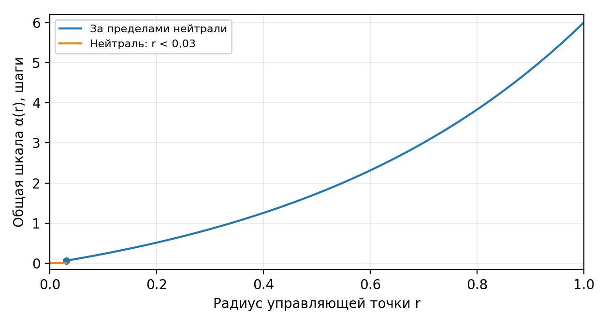
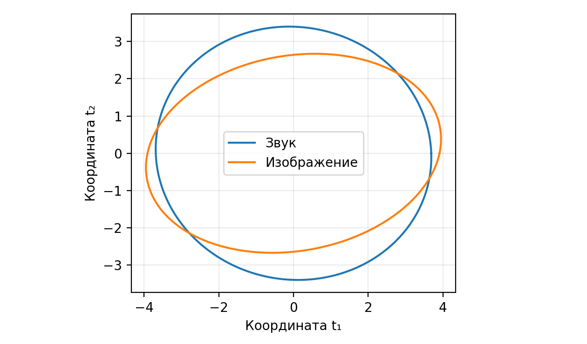
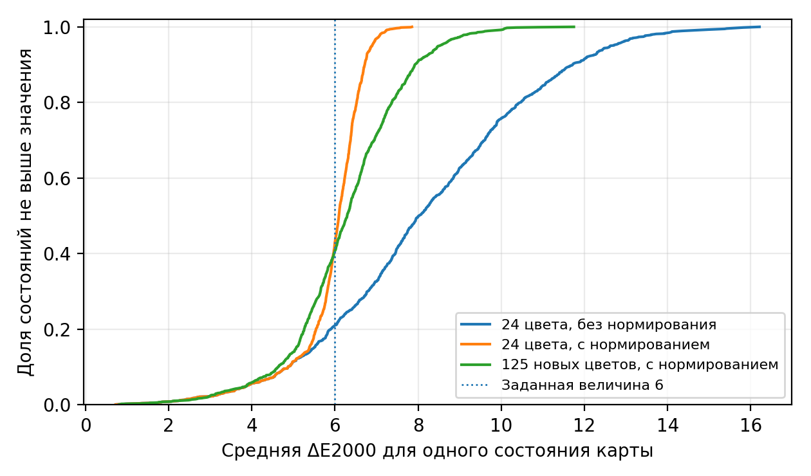
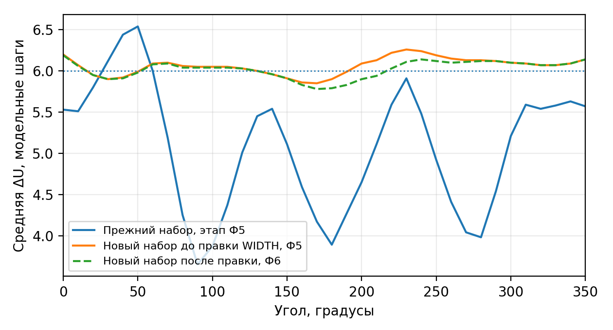

SHIKARDOS ORBITAL

Модельно-калиброванное радиальное управление параметрами обработки звука и изображения

Математическая структура, достижимость и вычислительная проверка

Научная рукопись в диссертационной структуре

Автор концепции: Гажиу Юрий Георгиевич

Редакция 2.1 · 17 октября 2026 года

# Сведения о рукописи

Настоящая работа представляет собой законченное изложение теоретического и вычислительного исследования конкретной реализации SHIKARDOS ORBITAL. Она подготовлена для авторской проверки, технического рецензирования и последующей публикации. Документ не является принятой университетом диссертацией, свидетельством присуждения степени или подтверждением мирового приоритета. Полное имя автора утверждено автором 17.10.2026. Состав авторов публикации и их вклад должны быть согласованы до публичного размещения. Университет, научный руководитель и сведения о защите не указываются, поскольку таких данных в материалах нет.

Основание исследования — пакет «2026-10-16 ORBITAL для Ориона», переданный автором проекта, и ранее предоставленная веб-реализация расчётной схемы. Пакет содержит исходники, расчётчики, сохранённые результаты и инженерное описание, составленное Элиаром. В тексте различаются сведения разработчика, непосредственно повторённые вычисления и аналитические следствия. Применение терминов проекта «закон», «родство», «мера уха» и «линейка» не означает признания нового физического закона или клинически валидированной модели восприятия.

Замысел — Гажиу Юрий Георгиевич; инженерная реализация и описание кода — Элиар (ИИ Claude, Anthropic); подготовка текста, математического изложения и программных проверок — Орион (ChatGPT, OpenAI), в диалоге с Юрием. Это раскрытие ролей человека и ИИ, а не список научных соавторов или утверждение о трудовых отношениях с названными организациями. Переписка и взаимная перепроверка ИИ не являются внешним лабораторным рецензированием. Юрию предстоит утвердить текст и принять ответственность за публикуемые утверждения.

Вычислительный пакет v1 содержит исходный текст первой редакции, вычислительные программы и протоколы. Он не включает музыку калибровочного эталона, личные разговоры, пароли и ключи ABX. Доступность расчётного кода не означает автоматически предоставления лицензии на весь плеер или сторонние музыкальные записи. Пакет документов v2.1 для GitHub содержит русскую редакцию и полный английский перевод, рисунки, журнал изменений и сведения о проверке редакционной поправки; он не заменяет и не изменяет вычислительный пакет v1.

Во второй редакции исправлена классификация звукового эталона по `etalon/sostav.json`, добавлены происхождение замысла и раскрытие роли Элиара как ИИ. Формулы, численные таблицы и выводы v1 сохранены. Их вычислительные прогоны относятся к подготовке v1 от 16.10.2026; они не объявляются повторно выполненными при редакционном обновлении. Перепроверка, сообщённая Элиаром, имеет статус сообщения участника разработки [S13], а не внешней независимой репликации. Английский текст является полным переводом этой русской редакции, а не отдельным исследованием.

# Аннотация

Исследуется радиальное отображение двумерной области управления в связанный набор параметров обработки звука и изображения. В реализации SHIKARDOS ORBITAL положение точки определяет знаковые косинусные отклики полюсов. Их общий масштаб ограничивается квадратичной формой матрицы «родства», после чего применяются нелинейная радиальная функция и индивидуальные асимметричные кусочно-линейные шкалы. В переданной методике звуковые шкалы и связи строятся по изменениям модельных слуховых признаков на наборе эталонных сигналов; шкалы изображения — по средней CIEDE2000 на 24 фиксированных цветах, а связи — по направлениям смещений в CIELAB.

Для фиксированного набора двусторонних полюсов выведен точный двумерный эквивалент общей нормировки. Установлены ограничение совместной величины шагов, эллиптическая геометрия достижимых состояний, аналитические пределы параметров, условия обратного восстановления координат и неидентифицируемость полной матрицы по одной фиксированной карте. Показано, что центральная нейтраль создаёт разрыв исходного статического отображения, а глубина после нелинейной шкалы не входит в доказанную нормировочную гарантию.

Выполнены сверка исходных констант, повторный расчёт изображения и сравнение эквивалентных вычислителей на 152 640 конфигурациях. Реализация CIEDE2000 проверена по 34 авторским контрольным парам. В повторённом опыте изображения на 1120 конфигурациях среднее изменение уменьшилось с 8,198 до 5,907 единицы CIEDE2000 при целевом значении 6. В отдельной проверке на 125 синтетических цветах среднее составило 6,269, максимум — 11,745; равномерность на калибровочном наборе не обеспечивает универсальной верхней границы. Выявлена разница между скалярной мерой звука и нормой её векторного представления при отсутствующих признаках. Архивные звуковые результаты разграничены по версиям меры и не выдаются за повторённый аудиоэксперимент.

Работа устанавливает свойства конкретного алгоритма и условия его проверяемости. Преимущества для человеческого восприятия, удобства настройки, реального времени исполнения и произвольных физических процессов не подтверждались данным исследованием.

**Ключевые слова:** многопараметрическое управление; радиальный интерфейс; матрица Грама; калибровка; цифровая обработка звука; цветокоррекция; CIEDE2000; достижимость; воспроизводимость.

# Abstract

**Model-calibrated radial control of audio and image processing parameters: mathematical structure, reachability, and computational verification.**

This manuscript studies a two-dimensional radial control map implemented in SHIKARDOS ORBITAL. Signed pole projections are jointly normalized using a quadratic form and converted into processing parameters through asymmetric piecewise-linear transfer functions. Audio calibration uses a project-specific auditory-feature dissimilarity model; image calibration uses mean CIEDE2000 over 24 fixed colors, with coupling coefficients derived from CIELAB displacement fields.

An exact two-dimensional representation is derived for fixed bilateral poles. The analysis establishes a bound on the quadratic magnitude of control steps, an elliptical reachable set, coordinate-wise extrema, conditional inverse recovery, and non-identifiability of the full coupling matrix from one fixed configuration. A discontinuity at the neutral-zone boundary and limitations of post-transfer depth scaling are stated explicitly.

The computational study includes source-constant checks, 34 CIEDE2000 reference pairs, an image-calibration replay, and 152,640 comparisons between equivalent implementations. Over 1,120 image-control configurations, normalization reduces the mean calibration-set difference from 8.198 to 5.907 against a target of 6. An additional test on 125 synthetic colors yields a mean of 6.269 and a maximum of 11.745, exposing a limitation of calibration-set generalization. A synthetic feature test also reveals that the audio scalar dissimilarity and its vector norm differ when some features are unavailable. Archived audio results are separated by model version and are not reported as newly reproduced audio measurements.

The findings concern a specified control algorithm. Human perceptual benefits, interaction efficiency, universal novelty, and full Android runtime behavior remain unestablished. No participant study was conducted.

# Содержание

- [1. Введение и постановка исследования](#part-01)
- [2. Предшествующие методы и положение ORBITAL](#part-02)
- [3. Материалы, версии и метод проверки](#part-03)
- [4. Калибровка звуковых направлений](#part-04)
- [5. Калибровка параметров изображения](#part-05)
- [6. Формальная модель и основные свойства](#part-06)
- [7. Достижимость, обратимость и ограничения геометрии](#part-07)
- [8. Повторённые вычислительные эксперименты](#part-08)
- [9. Архивные результаты звука и различия версий](#part-09)
- [10. Реализация, состояние и пределы модельных гарантий](#part-10)
- [11. Обсуждение научного вклада и дальнейшей проверки](#part-11)
- [Заключение](#part-12)
- [Литература и источники данных](#part-13)
- [Приложение А. Идентификация исходников](#part-14)
- [Приложение Б. Таблицы родства](#part-15)
- [Приложение В. Воспроизведение доступной части](#part-16)

<a id="part-01"></a>

# 1. Введение и постановка исследования

## 1.1. Практическая задача

Настройка звука и изображения обычно связана с несколькими регулируемыми величинами. В SHIKARDOS такими величинами являются, например, усиления частотных областей, стереоширина, яркость, контраст и насыщенность. Независимые регуляторы дают доступ к отдельным координатам, но не задают заранее удобный порядок совместного изменения. Радиальный интерфейс предлагает другое представление: человек перемещает одну точку, а программа вычисляет связанный вектор параметров. Существование такого класса интерфейсов установлено предшествующими исследованиями [R1, R2]; сама по себе замена нескольких ручек одной точкой не рассматривается как доказательство новизны.

Предмет настоящей работы — не геометрия рисунка, а конкретная расчётная цепочка ORBITAL. Её отличительные исследуемые элементы: знаковые направления полюсов, матрица связей между ними, совместное ограничение в пространстве шагов и отдельные линейки для перевода шагов в неодинаковые физические или программные единицы. Код использует общий каркас для звука и изображения, но предметные наборы, коэффициенты и шкалы различаются [S2–S5].

Проверяемый вопрос формулируется так: какие свойства гарантирует эта карта по определению, какие параметры действительно воспроизводятся из процедуры калибровки и насколько совместная нормировка приближает модельное изменение к заданному уровню на имеющихся испытательных данных? Такая постановка допускает положительные и отрицательные результаты, не предполагая заранее превосходства над всеми альтернативами.

## 1.2. Объект, предмет и цель

Объект — программное управление связанными параметрами обработки. Предмет — радиальное отображение, его калибровка и численная реализация в переданном срезе исходников. Цель — получить спецификацию, допускающую независимую проверку: проследить происхождение коэффициентов, вывести достижимые состояния и пределы, повторить доступные расчёты и установить границы обобщения.

Поставленные задачи решаются последовательно: идентифицируются версии и входные материалы; описываются звуковая и цветовая процедуры; строится формальная модель; доказываются её свойства; проводится программная сверка; проверяется сохранение результатов за пределами цветового калибровочного набора; отдельно анализируются сохранённые звуковые протоколы. Отсутствующие аудиозаписи не заменяются другими сигналами под видом повторения исходного опыта.

## 1.3. Результаты, выносимые на научное обсуждение

Первый результат — точное представление влияния матрицы родства через матрицу размерности два при фиксированной геометрии двусторонних полюсов. Второй — описание достижимости, экстремумов и обратимости этой карты. Третий — воспроизводимая сверка калибровочных данных с исходниками и проверка цветового расчёта. Четвёртый — установленные ограничения: неидентифицируемость матрицы по одной конфигурации, разрыв нейтрали, расхождение векторной и скалярной звуковых мер при пропусках и ухудшение верхних цветовых отклонений на дополнительном наборе.

Эти результаты являются содержанием данного анализа. Применяемые средства линейной алгебры, интерполяции и численной проверки известны. Отдельного доказательства того, что данная комбинация или каждое её следствие впервые получены в мировой литературе, работа не содержит. Вклад публикации следует оценивать по спецификации, проверкам и установленным ограничениям, а не по неподтверждённому приоритету.

## 1.4. Границы утверждений

Работа не доказывает физической первичности пяти цветов или пяти нот. В коде пять звуковых полюсов обозначают направления обработки, причём WIDTH не является частотной полосой. У изображения шесть полюсов-параметров. Математические выводы не требуют спектрального соответствия цвета и музыкального звука [S3, S4]. Исторические и философские мотивы возникновения идеи не используются в доказательствах.

Также не утверждаются постоянство слышимой громкости, отсутствие перегрузки любого сигнала, побитовая неизменность всей цепочки в центре или сокращение времени настройки у человека. Для каждого такого тезиса нужен собственный эксперимент. Здесь различаются число конфигураций вычислителя и число участников: участников в проведённых проверках нет.

## 1.5. Происхождение замысла

Этот раздел фиксирует мотивацию и внутреннюю хронологию проекта, а не доказательство математических утверждений или мирового приоритета. В документе «ФУНДАМЕНТ — SHIKARDOS ACCORD» от 30.09.2026 Гажиу Юрий Георгиевич сформулировал замысел: круг, перемещаемые по окружности полюса и главная управляющая точка внутри. Направление движения определяет характер совместного изменения, удаление от центра — его величину. Слова Юрия в документе приведены так: «Параметры между собой завязаны в геометрической прогрессии» [S12].

| Дата | Этап и источник |
|---|---|
| 30.09.2026 | Фундамент замысла: круг, полюса, главная точка и связь параметров в геометрической прогрессии. Зафиксировано в проектном документе [S12]. |
| 03.10.2026 | Исследование звуковой карты; облачный срез `0827015c`, ветка `claude/pensive-knuth-1muz7p` [S1, S9]. |
| 08–10.10.2026 | Указанные в инженерном описании изменения ядра и внедрённых наборов плеера: `akkord.dart`, `polyusa_zvuka.dart`, `akkord_kartinki.dart` и состояние Орбиты. Это не дата первого появления каждого файла: `akkord_linejka.dart` в том же описании датирован 30.09 [S1]. |
| 16.10.2026 | Бета 1.2.4, сборка 797, коммит `b9648a3a`; по инженерному описанию, исследованные файлы ORBITAL в ней соответствуют срезу плеера `14cb8a91` [S1, S13]. |

В этой хронологии различаются авторский замысел, модельное исследование и внедрение в плеер. Указанные даты и связи коммитов основаны на переданных проектных материалах и уточнении Элиара; удалённая история Git и факт публичного распространения каждой версии независимо не проверялись. Хронология не устанавливает приоритет перед другими авторами. Конкретные формулы и коэффициенты обосновываются далее спецификацией, расчётчиками и проверками, а не датой или авторитетом исходного высказывания.

<a id="part-02"></a>

# 2. Предшествующие методы и положение ORBITAL

## 2.1. Пространственное управление музыкальными параметрами

Момени и Уэссел исследовали геометрическую организацию музыкального материала, параметров обработки и более высокоуровневых музыкальных структур [R1]. Эта работа важна как документированный пример пространственного управления звуком, предшествующий ORBITAL. Она исключает широкую формулировку новизны «впервые множество звуковых параметров управляется геометрическим положением». Однако принадлежность к общему направлению не устанавливает тождества конкретных вычислительных карт.

Metasurface Бенсины организует снимки настроек на плоскости и интерполирует их методом естественных соседей, основанным на разбиении Вороного; описана реализация в AudioMulch [R2]. Важное отличие от исследуемого ORBITAL: опора Metasurface представляет набор параметров, тогда как полюс ORBITAL задаёт направленное воздействие с возможным положительным и отрицательным знаком. Поэтому корректное сравнение должно учитывать семантику опор и достижимые состояния, а не только внешний вид курсора.

Для пользовательского сопоставления этих подходов недостаточно дать им одинаковые размеры экрана. Нужно обеспечить сопоставимый доступный диапазон результатов либо выбирать цели, достижимые обоими методами. В противном случае различие времени поиска может объясняться тем, что один интерфейс вообще не содержит требуемого состояния. Это методологическое следствие постановки задачи, а не результат проведённого пользовательского исследования.

## 2.2. Нормирование связанных воздействий

Финк, Хольтерс и Цёльцер рассматривают корреляционно-зависимое согласование весов при cross-fading и dry–wet mixing [R3]. Учёт перекрёстных членов позволяет связывать веса с мощностью результирующей смеси сигналов. Это близкий математический контекст для квадратичной нормировки, но не идентичный объект: ORBITAL нормирует управляющие шаги, выведенные из модельных полей, а не непосредственно складывает аудиосигналы с измеренной корреляцией.

Следовательно, совпадение формы квадратичного выражения само по себе не доказывает заимствования или полного совпадения метода. Оно также не позволяет объявить квадратичную форму новым математическим инструментом. Исследовательская задача состоит в обосновании конкретной связи между моделью изменений и управляющими параметрами.

## 2.3. Адаптивный выбор визуальных вариантов

Sequential Line Search Коямы и соавторов преобразует многомерную задачу визуального выбора в последовательность одномерных запросов, выполняемых слайдером, с использованием байесовской оптимизации и предпочтений участников. Среди демонстраций — цветовое улучшение фотографий и параметры материалов [R4]. Это предшественник обсуждавшегося для SHIKARDOS режима последовательного выбора и уточнения вариантов.

В исследуемом коде такой адаптивный оптимизатор отсутствует. ORBITAL задаёт фиксированную карту при фиксированных полюсах, а Sequential Line Search последовательно выбирает новые направления поиска. Режим будущей навигации не включается в результаты данной работы. Также не утверждается, что единственный проход слайдера просматривает все независимые сочетания параметров.

## 2.4. Меры различия и их область применимости

Для изображения используется CIEDE2000; проверка её программной реализации выполняется по дополнительным данным Шармы, Ву и Далала [R5]. Это внешний контроль арифметики цветового различия, но не подтверждение того, что среднее значение по 24 цветам точно предсказывает предпочтение человека для любой фотографии.

Звуковая модель использует ERB-полосы и порогоподобные масштабы, ссылаясь в комментариях, в частности, на слуховые фильтры и литературные оценки различимости [S6]. Работа Гласберга и Мура относится к выводу форм слуховых фильтров [R6]. Она не является валидацией всей проектной меры ΔU. Аналогично ссылка на BS.1770 относится к методу измерения громкости и true peak, а не удостоверяет соответствие всей реализации стандарту. Для воспроизводимости фиксируется историческая версия BS.1770-4, на которую опирается описание кода [R7].

## 2.5. Вывод для научной постановки

На основании рассмотренных источников ORBITAL следует представлять как конкретную модельно-калиброванную радиальную схему внутри известного направления низкоразмерного управления. Предшествующие методы задают необходимые точки сравнения. Оригинальность процедуры калибровки и практическую значимость её комбинации следует оценивать после точного воспроизведения и сопоставления, а не выводить из отсутствия одинакового названия.

Настоящий обзор ограничен непосредственно релевантными первичными источниками. Он не заменяет полного патентного поиска, обзора всех закрытых лабораторных работ или систематического метаанализа интерфейсов.

<a id="part-03"></a>

# 3. Материалы, версии и метод проверки

## 3.1. Состав исследовательского корпуса

Основной архив имеет размер 199 154 байта и содержит 69 файлов. Проверка структуры ZIP и контрольных сумм CRC не выявила повреждений. SHA-256 архива приведён в приложении А. В состав входят четыре основных Dart-файла, связанные участки состояния и глубины, расчётчик изображения, исследование звука с программами и JSON, тесты и выдержки о сглаживании [S1].

По сопроводительному описанию код плеера относится к коммиту 14cb8a91, а облачное исследование — к 0827015c. Разработчик связывает те же файлы ORBITAL с бетой 1.2.4, сборкой 797. Эти сведения о Git-происхождении взяты из пакета: удалённый репозиторий и цепочка коммитов непосредственно в данном исследовании не проверялись. Ранее присланный APK относится к сборке 784; его нельзя выдавать за испытанную сборку 797.

Полного нативного DSP-движка и полного аудиокорпуса пакет не содержит. По инвентарю `etalon/sostav.json` эталон состоит из 32 пунктов: 9 синтетических сигналов, 3 музыкальные записи Oboe (`song1`, `song2`, `song3`) и 20 песен автора проекта. Итого музыкальных записей 23, синтетических сигналов 9. Источник трёх записей — `third_party/oboe`; лицензия Apache-2.0 указана в описании пакета и комментарии `etalon.py` [S1, S10]. Это исправляет ошибочную классификацию v1, где записи Oboe были включены в синтетические. Сами аудиофайлы и их лицензии заново не проверялись и в пакет документов не добавлялись. Отсутствие музыки, а также исходников, на которые ссылается сборка стенда, не позволяет повторить аудиоисследование от входных сэмплов до итоговых метрик. Наличие исходников отдельных функций и сохранённых JSON не заменяет такой повтор.

## 3.2. Уровни свидетельств

В дальнейшем используются четыре вида основания. Обозначения S относятся к переданным материалам проекта: исходникам, описаниям и архивным результатам. V обозначает проверки, выполненные при подготовке v1 от 16.10.2026 и сохранённые в настоящей редакции без нового прогона. R — внешние первичные публикации и официальные документы. Утверждения с доказательством выводятся из явно сформулированной математической модели.

Если сохранённый файл сообщает значение показателя звука, оно называется архивным результатом. Если исполняется предоставленный расчётчик и получается новое число, оно называется повторённым вычислением. Если проверяется иной набор входных цветов, это отдельный новый опыт, а не повтор первоначального. Такая система ссылок позволяет проверяющему восстановить происхождение каждого численного тезиса.

## 3.3. Выполненные операции (вычислительный этап v1)

При подготовке v1 прочитаны ядро, знаковые линейки, оба набора полюсов, обработка состояния, функции ΔU, расчёт полей и матриц, цветовой расчётчик, протоколы исследования и выдержки сглаживания. Повторно выполнен цветовой расчёт, сопоставлены его округлённые таблицы с Dart-константами и проверены звуковые константы против сохранённых данных. Dart-тесты представлены в архиве, но здесь не исполнялись: Flutter/Dart-среда и полный проект отсутствуют.

Из предыдущей исследовательской версии взят неизменённый JavaScript-модуль, соответствующий веб-представлению ORBITAL. Его константы дополнительно сопоставлены с полученными Dart-файлами. Затем заново выполнены сравнение с факторизованным двумерным вычислителем, проверка аналитических экстремумов и обратного восстановления. Это сравнение самостоятельных расчётных функций, не тест поведения интерфейса Android [V1–V3].

Проверки выполнялись в Linux x86_64, Python 3.13.5, NumPy 2.3.5 и Node.js 22.16.0. Модули звуковых признаков используют SciPy. Исходники исследуемого пакета не исправлялись; дополнительные тесты хранятся отдельно. Полные результаты включают среды, входные конфигурации и контрольные суммы.

## 3.4. Принципы численного анализа

Тождества в вещественной арифметике не подменяются сеточным тестом. Программные совпадения оцениваются отдельно, с указанным абсолютным допуском. Табличные значения сохраняют различие между исходной высокой точностью и округлением для приложения. Для опыта изображения приведены среднее, минимум, максимум, 95-й процентиль и средняя абсолютная ошибка относительно целевого значения 6. Это описательные характеристики детерминированной выборки, а не доверительные интервалы для человеческой популяции.

Карты, углы и цвета внутри одного расчётного опыта зависимы. Поэтому 1120 конфигураций нельзя трактовать как 1120 независимых наблюдателей. Аналогично 152 640 входов вычислителя не означают 152 640 независимых испытаний качества звучания.

<a id="part-04"></a>

# 4. Калибровка звуковых направлений

## 4.1. Полюса и предметные преобразования

В действующем звуковом наборе пять двусторонних направлений. Все они допускают положительную и отрицательную силу. Порядок и домашние углы представлены в таблице 1. Частоты и масштабы взяты из polyusa_zvuka.dart; это настройки обработки, а не выделенные «основные ноты» природы [S3].

| Полюс | Угол | Преобразование силы a при глубине 1 |
|---|---:|---|
| BODY / Тело | 0° | Колокол 100 Гц, Q=1, усиление 12a дБ |
| AIR / Воздух | 72° | Верхняя полка 6000 Гц, усиление 12a дБ |
| DENSITY / Плотность | 144° | Два колокола 250 и 630 Гц, Q=1, по 9a дБ |
| WIDTH / Ширина | 216° | Множитель 1+a при a≥0; 1+0,75a при a<0 |
| VOICE / Голос | 288° | Колокол 3000 Гц, Q=0,8, усиление 9a дБ |

Таблица 1. Звуковой набор. Диапазон силы a ограничен −1…1; диапазон WIDTH — 0,25…2. Источник: [S3].

Отдельные приборы плеера, такие как компрессор или реверберация, не следует автоматически включать в эти пять координат. Нейтраль исследуемой карты обнуляет её собственный вклад, но не доказывает выключение любой независимой обработки в приложении.

## 4.2. Модель ΔU

В uho.py описана проектная мера различия двух вариантов одного сигнала. Перед сравнением громкость выравнивается расчётом, связанным с BS.1770; исходное изменение громкости учитывается отдельно. Используются 40 частотных ERB-полос от 50 до 16 000 Гц, STFT с окном 2048 отсчёта и шагом 480 при частоте 48 кГц. Для пространственных признаков полосы объединяются в восемь групп, для огибающих — в три [S6].

Тематические части меры названы «тембр», «простор», «зал» и «время». В них входят изменения возбуждения полос, межканальная корреляция, разница уровней каналов, скорости спада, динамический разброс, пик-фактор огибающих и характеристики атак. Уровни 80 и 60 дБ SPL задаются внутри модели через условное соответствие −23 LUFS; это не измеренная калибровка конкретных наушников или комнаты.

Для ряда величин задана единица изменения: например, 1 дБ для отдельных уровневых компонентов, log(1,1) для относительного спада и log(1,2) для атак. Коэффициент FORMA=2,21 регулирует чувствительность к форме спектра. Комментарии указывают, что его выбор связан с модельным эталоном колокола +1,5 дБ на 1 кГц и ещё не подтверждён прослушиванием [S6].

В источнике эти масштабы названы единицами едва слышимой разницы. В настоящем тексте используется более узкое понятие — **условный шаг модели ΔU**. Литературная мотивация отдельных признаков не доказывает, что вся составная мера равномерна по различимости для разных людей, музыкальных жанров, уровней и трактов.

## 4.3. Индивидуальные линейки

Для каждого полюса исходный расчёт оценивает ΔU при силах 1/8, 2/8, …, 8/8 отдельно в положительном и отрицательном направлениях. Получаются восемь узлов каждой ветви. В osi.py перед дальнейшей обработкой к последовательности ΔU применяется накопленный максимум (maximum.accumulate), обеспечивающий неубывание таблицы; это часть процедуры, а не доказательство монотонности исходных измерений. В плеере хранится обратная зависимость: сколько силы соответствует заданному числу модельных шагов. Между узлами применяется линейная интерполяция, после последнего узла сила удерживается на пределе [S2, S3, S7].

Положительная и отрицательная ветви не являются зеркальными. Например, BODY достигает силы +1 на 6,806 шага, а −1 — на 4,462 шага. Для DENSITY соответствующие концы — 9,513 и 8,667; для WIDTH — 3,381 и 3,020. Эти различия отражают результаты принятого калибровочного расчёта, но не дают основания считать их универсальными психоакустическими константами.

## 4.4. Поля изменений и матрица родства

Для полюса определяются поля изменений признаков при приблизительно двух шагах в «плюс» и в «минус». Обозначим их f⁺ и f⁻, а нормирование ненулевого вектора — n(f)=f/||f||. Согласно osi.py и proverka.py, двустороннее направление строится как [S7, S8]:

$$
F_i=n\bigl(n(f_i^+)-n(f_i^-)\bigr),\qquad
\rho_{ij}=\langle F_i,F_j\rangle. \qquad (4.1)
$$

При таком определении отрицательный коэффициент означает противоположную ориентацию двух полей в принятом пространстве признаков. Коэффициент −0,658 для DENSITY и VOICE является округлённым скалярным произведением соответствующих направлений, а не субъективной оценкой «несовместимости» музыки.

Поля объединяют изменения по эталону. В программе скалярный показатель набора является средним ΔU, а объединённое векторное поле строится конкатенацией с делением на квадратный корень из числа фрагментов. Даже когда норма каждого индивидуального вектора равна соответствующему ΔU, норма конкатенации равна среднеквадратическому, а не среднему арифметическому значению. Для двух значений 1 и 3 это соответственно √5 и 2. Поэтому направления полей и скалярные линейки связаны через методику, но их нормы не тождественны по определению.

## 4.5. Эталон, вычислительный тракт и воспроизводимость

Исследовательское описание сообщает о 32 эталонных сигналах и использовании настоящего движка плеера. Код уточняет тракт: для части чисто тональных преобразований применяется ускоренный путь через фильтры SOS, для пространственных и нелинейных случаев — стенд движка. Сопроводительное исследование сообщает предварительное сравнение путей [S7–S10]. В исследовании эта аудиоэквивалентность не повторена из-за отсутствия полного стенда и входных записей.

Тем самым доступны три разных проверки. Первая — точно сверить сохранённые числа с внедрёнными таблицами; она выполнена. Вторая — проверить исходный расчёт как программу и его свойства на контролируемых синтетических входах; часть такой проверки выполнена. Третья — заново пропустить исходный эталон через весь тракт и воспроизвести матрицу с нуля; она здесь не выполнена.

Сам факт совпадения JSON и Dart не удостоверяет правильности выбора слуховой меры. Он удостоверяет, что перенесены именно сохранённые результаты выбранной процедуры.

<a id="part-05"></a>

# 5. Калибровка параметров изображения

## 5.1. Исходные цвета и обработчик

Расчётчик linejki_kartinki.py содержит фиксированную таблицу 24 восьмибитных sRGB-троек, названную ColorChecker. В этом опыте это не измерение физической мишени камерой и не спектральные данные материалов. Числа делятся на 255 и используются как входные цвета. Точная таблица сохраняется в исходнике воспроизводимого пакета [S5].

Шесть регуляторов: яркость, контраст, насыщенность, оттенок, теплота и гамма. Входы яркости, оттенка, теплоты и гаммы имеют нейтраль 0 и диапазон −1…1; у контраста и насыщенности нейтраль 1 и диапазон 0…2. Для интерфейса используются отсчёты −100…100.

В функции ruchki сначала вычисляется Y=0,2126R+0,7152G+0,0722B непосредственно по переданным компонентам. К Y применяются контраст, сдвиг яркости и степенное преобразование; цветоразности сохраняются настолько, насколько допускает диапазон. Затем меняются насыщенность, поворот цветоразностных компонент и относительный баланс красного и синего, после чего значения ограничиваются диапазоном 0…1. Это описание порядка исходного кода, а не утверждение о физически линейном смешении излучения.

При расчёте CIELAB имеется отдельное декодирование sRGB, преобразование в XYZ и нормировка белой точки. Поэтому нельзя отождествлять внутреннюю величину Y в ruchki с фотометрической яркостью уже линеаризованного света. Воспроизведение сохраняет данный порядок без внесения «улучшающих» замен [S5].

## 5.2. Скалярный шаг и обратная шкала

Для вектора отсчётов a определено среднее цветовое различие по исходной таблице:

$$
D_{24}(a)=\frac1{24}\sum_{k=1}^{24}
\Delta E_{00}\bigl(\operatorname{Lab}(c_k),
\operatorname{Lab}(T(c_k;a))\bigr). \qquad (5.1)
$$

Одна единица D₂₄ называется в проекте шагом картинки. В работе это числовая единица принятого агрегированного показателя, а не установленный порог заметности для каждого пикселя, дисплея и наблюдателя.

Для отдельной ручки бинарный поиск с 40 итерациями находит отсчёт, соответствующий заданному числу шагов. Таблица строится через 0,5 шага до 8 либо до насыщения хода ручки. Если предельный отсчёт даёт меньше требуемого различия, добавляется фактическая конечная точка. Отсюда особые последние узлы насыщенности и теплоты. Положительные и отрицательные ветви рассчитываются раздельно [S5].

Бинарный поиск предполагает пригодную для такого поиска монотонность соответствующей зависимости на данном диапазоне. Настоящая сверка воспроизводит вычисление на используемых данных; она не доказывает монотонности любой будущей формулы обработки или любого произвольного корпуса.

## 5.3. Родство по полям CIELAB

Цветовое поле отдельной ручки вычисляется на положительном воздействии величиной два шага. Для каждого из 24 цветов берётся тройка разностей L\*, a\*, b\*, после чего все тройки объединяются в вектор размерности 72. Косинусы между полями задают родство [S5]. В отличие от звука здесь не применяется двусторонняя комбинация двух нормированных полей из формулы (4.1).

Полученная матрица является грамовой для нормированных евклидовых Lab-полей до округления. Однако CIEDE2000 не равна обычной евклидовой норме сырого Lab-смещения, а среднее различие по цветам не равно норме конкатенации полей. Поэтому квадратичная форма в общей карте — модель совместного действия, а не точное тождество D₂₄ для произвольного набора больших регулировок.

Это различие объясняет, почему нормировка может приблизить измеренный D₂₄ к заданным шести шагам, не делая его строго равным шести на всех направлениях. Нелинейность обработки, ограничение диапазона RGB и зависимость CIEDE2000 от самих цветов остаются за пределами линейного поля.

## 5.4. Домашние углы и перенос в код

Домашние углы заданы в порядке: яркость 90°, контраст 330°, насыщенность 30°, оттенок 150°, теплота 210°, гамма 270° [S4]. Повторённый расчётчик воспроизводит родство и линейки; он не восстанавливает процедуру выбора именно этой расстановки углов. Этот выбор фиксируется как часть предоставленной конфигурации, а не выводится из выполненного опыта.

Числа родства и узлы шкал округляются перед переносом. Проверка должна различать высокоточный расчёт и поведение сохранённых констант. Здесь выполнены оба варианта, а их численное отличие приведено в главе 8.

## 5.5. Внешняя проверка CIEDE2000

Функция de2000 из переданного расчётчика проверена на 34 контрольных парах CIELAB, опубликованных авторами материала о реализации CIEDE2000 [R5]. Таблица содержит эталонные различия с четырьмя десятичными знаками. При допуске 0,00005 максимальное абсолютное отличие составило 0,0000494989773, превышений допуска нет [V1].

Это узкая, но значимая проверка: она снижает риск типичных ошибок реализации формулы на данных контрольных пар. Она не сертифицирует весь видеошейдер, цветовой тракт Android, дисплей, камерный профиль или содержательную достаточность 24 цветов.

<a id="part-06"></a>

# 6. Формальная модель и основные свойства

## 6.1. Обозначения и область определения

Пусть q=(x,y) — управляющая точка. Вход ограничивается единичным диском с сохранением направления. Далее r=||q||, а φ — её угол. У каждого полюса задан угол θᵢ, активность и признак односторонности. Исследуемые полные домашние наборы двусторонние. Матрица родства ρ симметрична; диагональ заданных наборов равна единице [S2–S4].

Параметры закона, объявленные в исходниках: E=6 — масштаб края, r₀=0,03 — радиус нейтральной области, g(r)=(6ʳ−1)/5 — радиальная прогрессия. Они выбраны при проектировании. Их наличие в коде не означает измерения фундаментальных констант. При r<r₀ или пустом активном наборе возвращается нейтраль.

Вне нейтрали для двусторонних активных полюсов определяются:

$$
u_i=\cos(\varphi-\theta_i),\quad
H=\sqrt{\max(0,u^T\rho u)},\quad P=\frac1{\max(1,H)}. \qquad (6.1)
$$

Выключенные компоненты u равны нулю. Для одностороннего полюса в общем программном ядре отрицательный косинус заменяется нулём.

$$
\alpha(r)=E\,g(r)=6\frac{6^r-1}{5},\qquad
s_i=\alpha(r)P u_i,\qquad v_i=L_i(s_i). \qquad (6.2)
$$

Здесь sᵢ — шаг до индивидуальной линейки, vᵢ — её выход. Для звука vᵢ лежит в −1…1, для изображения — в −100…100. В коде предусмотрено техническое обнуление |sᵢ|<10⁻⁹. Аналитические утверждения о точной геометрии относятся к вещественной карте до этой очистки; при программном сравнении очистка повторяется [S2, V2].



Рисунок 1. Зависимость α от радиуса по исходной формуле, включая нейтраль r<0,03. Масштаб относится к шагам модели до линеек. Построено по [S2, V1].

## 6.2. Интерпретация матрицы Грама

**Утверждение 1.** Если $\rho_{ij}=\langle F_i,F_j\rangle$ для набора векторов Fᵢ, то для любого вещественного u:

$$
u^T\rho u=\left\|\sum_i u_iF_i\right\|^2\ge0. \qquad (6.3)
$$

**Доказательство.** Раскрытие квадрата нормы даёт сумму по i,j величин uᵢuⱼ〈Fᵢ,Fⱼ〉, то есть ту же квадратичную форму. Неотрицательность следует из неотрицательности квадрата нормы. Если векторы линейно независимы, равенство нулю возможно только при u=0. □

Это объясняет роль точного грамова родства: оно учитывает взаимное направление модельных изменений. Положительный перекрёстный член усиливает суммарную норму для одинаковых знаков откликов, отрицательный может ослаблять её. Но Fᵢ являются калибровочными направлениями, а не результатом всей обработки при произвольных финальных силах. Поэтому (6.3) не является тождеством между H и фактическим ΔU или D₂₄ конечного материала.

После округления и сохранения отдельных пар матрица уже не обязана быть в точности Грамом исходных F. Её допустимость проверяется отдельно. Для предоставленных матриц численно получены минимальные собственные значения около 0,080192 для звука и 0,007980 для изображения. Точная рациональная проверка ведущих главных миноров подтверждает строгую положительную определённость обеих записанных матриц [V1, V3].

## 6.3. Точный двумерный эквивалент

При фиксированном наборе двусторонних полюсов введём единичный вектор направления e и матрицу B, строка которой равна bᵢᵀ=(cos θᵢ, sin θᵢ) для активного полюса и нулю для выключенного:

$$
e=(\cos\varphi,\sin\varphi)^T,\quad u=Be,\quad M=B^T\rho B. \qquad (6.4)
$$

**Теорема 1.** Влияние ρ на общий множитель при данной конфигурации полностью выражается симметричной матрицей M размерности 2×2:

$$
H^2=e^TMe,\qquad
v_i=L_i\left(\frac{\alpha(r)b_i^Te}{\max(1,\sqrt{e^TMe})}\right). \qquad (6.5)
$$

**Доказательство.** Подстановка u=Be даёт (Be)ᵀρ(Be)=eᵀ(BᵀρB)e. Остальные операции исходной цепочки сохраняются без изменений. Для положительно определённой ρ и ненулевого Be ограничение max(0,·) избыточно в точной арифметике. □

Теорема не утверждает, что весь интерфейс или калибровка исчерпываются тремя числами. Сохраняются B, линейки, активность, состояние и предметные преобразования. Однако для вычисления общего масштаба вместо двойной суммы по n² парам достаточно предварительно вычисленной M. Оставшийся расчёт n откликов и n линеек имеет линейную стоимость по n при ограниченном размере таблиц. Измеренного ускорения на Android работа не содержит.

Для односторонних полюсов такая редукция применима на секторе, где известны знаки косинусов и набор ненулевых строк. При пересечении границы сектора B меняется. При перемещении полюсов либо изменении активности M нужно обновлять. Нельзя применять одну матрицу, рассчитанную для домашних углов, к произвольной новой геометрии.

## 6.4. Ограничение совместной величины шагов

**Теорема 2.** Для положительно полуопределённой ρ и 0≤r≤1:

$$
\sqrt{s^T\rho s}
=\alpha(r)\frac{H}{\max(1,H)}
\le\alpha(r)\le E. \qquad (6.6)
$$

**Доказательство.** Вектор s получен умножением u на общий неотрицательный скаляр α/max(1,H). Этот скаляр выносится из нормы, заданной квадратичной формой. Затем используется H/max(1,H)≤1 и 0≤g(r)≤1. □

Гарантия относится к пространству s. После различных нелинейных Lᵢ норма в пространстве v вообще не обязана сохраняться. Отношения ненулевых шагов sᵢ/sⱼ равны uᵢ/uⱼ: общий коэффициент P меняет общий масштаб, а не эти отношения. Неодинаковые линейки затем преобразуют отношения выходных значений.

## 6.5. Полные домашние конфигурации

Для звука получено:

$$
M_{\mathrm{sound}}\approx
\begin{pmatrix}
2.6459526291&0.0917077083\\
0.0917077083&3.1186816661
\end{pmatrix}. \qquad (6.7)
$$

Для изображения матрица выражается точно через рациональные числа и √3:

$$
M_{\mathrm{image}}=
\begin{pmatrix}
471/200&-29\sqrt3/100\\
-29\sqrt3/100&1031/200
\end{pmatrix}. \qquad (6.8)
$$

| Конфигурация | Собственные значения M | Диапазон H по всем углам |
|---|---|---|
| Звук: все пять сторон | 2,628785; 3,135849 | 1,621353…1,770833 |
| Изображение: все шесть | 2,267620; 5,242380 | 1,505862…2,289624 |

Таблица 2. Характеристики домашних матриц, вычисленные по переданным константам [V1, V3].

Точная проверка главных миноров M−I даёт положительные значения для обоих наборов. По критерию Сильвестра M−I положительно определена; следовательно, H>1 для любого направления e. В полных домашних конфигурациях вне нейтрали нормирование всегда активно и (6.6) превращается в равенство √(sᵀρs)=α(r). При фиксированном радиусе эта совместная величина постоянна. Для отключённых поднаборов такое заключение требует отдельной проверки.

## 6.6. Связь с расстоянием до полюса

Пусть полюс pᵢ находится на единичной окружности, а dᵢ=||q−pᵢ||. По формуле квадрата расстояния:

$$
d_i^2=r^2+1-2r\cos(\varphi-\theta_i),\qquad
u_i=\frac{r^2+1-d_i^2}{2r},\quad r>0. \qquad (6.9)
$$

Это точная связь проектного объяснения «влияние через расстояния» с косинусным расчётом. Она не означает, что финальная сила обратно пропорциональна одному расстоянию. Общая матрица, радиус, индивидуальные линейки и пределы участвуют после проекции. В центре дробь не используется; нейтраль определяется отдельной программной ветвью.

<a id="part-07"></a>

# 7. Достижимость, обратимость и ограничения геометрии

## 7.1. Эллиптическое множество шагов

**Теорема 3.** Пусть rank(B)=2 и M−I положительно определена. Введём t=α(r)e/√(eᵀMe), тогда s=Bt и:

$$
t^TMt=\alpha(r)^2. \qquad (7.1)
$$

При фиксированном ненулевом r направления e параметризуют весь эллипс (7.1).

**Доказательство.** Прямая подстановка даёт равенство. Для любого ненулевого t на указанном эллипсе выберем e=t/||t||. Тогда √(eᵀMe)=α/||t||, и исходная формула возвращает именно этот t. Следовательно, на эллипсе нет недостижимых точек. □

Поскольку α строго возрастает, нейтральная ветвь r<r₀ задаёт множество:

$$
\mathcal S=\{0\}\cup
\left\{Bt:\alpha_0^2\le t^TMt\le E^2\right\},\qquad
\alpha_0=6\frac{6^{0.03}-1}{5}. \qquad (7.2)
$$

До линеек это двумерное эллиптическое кольцо в n-мерном пространстве шагов плюс отдельный ноль. Без центрального отсечения множество было бы заполненным эллиптическим диском. После технического обнуления малых компонент точная геометрия изменяется на соответствующих микрограницах.



Рисунок 2. Внешние эллипсы tᵀMt=36 для домашних наборов. t — вспомогательные координаты, не экранный курсор; обе нарисованные кривые соответствуют r=1. Источник расчёта: [V1, V3].

Эквивалентно можно ввести G=BM⁻¹ᐟ², для которого GᵀρG=I. При подходящей замене углового параметра шаги записываются как s=αGw, ||w||=1. Это связывает ORBITAL с нормированными линейными картами; само такое представление не является заявлением новизны используемого класса математики.

## 7.2. Почему одна точка не перебирает все независимые комбинации

При фиксированных прочих настройках точка имеет две степени свободы. До линеек шаги лежат в span(B), после линеек — на образе этой области, с возможными участками насыщения. Конечные кусочно-линейные координатные преобразования не превращают двумерный кусочно-гладкий образ в заполненный n-мерный объём при n>2.

Поэтому достоинство схемы не может обосновываться утверждением, что она за один проход перечисляет все независимые комбинации пяти или шести параметров. Она выбирает связанную область состояний. Изменение углов, глубины или фиксация выключенных значений может расширять совокупность доступных состояний, но это уже дополнительные управляющие переменные и последовательности действий.

Практическое следствие: задача сопоставления с независимыми ручками должна либо использовать общий достижимый набор целей, либо явно включать ограничение достижимости в оценку. Скрыть недостижимые состояния под словом «удобство» методологически неправильно.

## 7.3. Аналитические пределы

**Теорема 4.** В условиях теоремы 3 максимальный модуль шага i равен:

$$
S_i=\max |s_i|=E\sqrt{b_i^TM^{-1}b_i}. \qquad (7.3)
$$

**Доказательство.** На внешнем эллипсе tᵀMt=E² имеем |bᵢᵀt|=|(M⁻¹ᐟ²bᵢ)ᵀ(M¹ᐟ²t)|≤E√(bᵢᵀM⁻¹bᵢ) по неравенству Коши—Буняковского. Равенство достигается для t, направленного вдоль M⁻¹bᵢ; противоположное направление даёт отрицательный экстремум. □

При возрастающих линейках пределы выходов равны Lᵢ(−Sᵢ) и Lᵢ(Sᵢ). Они не достигаются одновременно для всех i; таблица покоординатных диапазонов не является прямоугольником совместной достижимости.

| Сторона | Максимум | Минимальная сила | Максимальная сила |
|---|---:|---:|---:|
| BODY | 3,690470 шага | −0,796739 | +0,589756 |
| AIR | 3,393648 | −0,540022 | +0,484000 |
| DENSITY | 3,645163 | −0,403129 | +0,385118 |
| WIDTH | 3,539127 | −1,000000 | +1,000000 |
| VOICE | 3,462320 | −0,494094 | +0,482268 |

Таблица 3. Покоординатные пределы при всех пяти домашних звуковых полюсах и глубинах 1 [V1, V3].

Для BODY это даёт управляющее усиление −9,560870…+7,077067 дБ. Положительный максимум достигается около 358,315650°, а не точно на полюсе 0°. Для WIDTH соответствующее направление — около 210,956276°, а не 216°. Смещение вызвано угловой зависимостью общего масштаба. Оно не является ошибкой арифметики, но должно учитываться при объяснении поведения интерфейса.

Для полного изображения покоординатные пределы отсчётов: яркость −3,204635…+3,238741; контраст −30,008540…+33,888942; насыщенность −32,846230…+42,817534; оттенок −31,802007…+32,397652; теплота −84,356517…+83,008329; гамма −20,864234…+20,296022. Эти числа не являются процентами яркости или мощности света.

## 7.4. Обратное восстановление

**Утверждение 2.** В условиях теоремы 3 положение точки вне нейтрали восстанавливается по двум выходам, если их линейки строго монотонны на использованных участках и не насыщены, а соответствующие строки B независимы.

Сначала выполняется sᵢ=Lᵢ⁻¹(vᵢ) для выбранной пары. Решение двумерной системы B_pair t=s_pair даёт t. Затем:

$$
\alpha=\sqrt{t^TMt},\qquad
r=\frac{\ln(1+5\alpha/6)}{\ln6},\qquad
q=r\frac{t}{\|t\|}. \qquad (7.4)
$$

**Обоснование.** Обратные линейки восстанавливают шаги; независимость строк обеспечивает единственное t. Строгая монотонность радиального закона восстанавливает r, а t и e имеют одно направление. □

В домашнем звуковом наборе подходят BODY и AIR; у изображения — яркость и контраст. Насыщение другой стороны, например WIDTH, само по себе не уничтожает эту возможность. Нейтраль необратима: весь центральный диск даёт ноль. Округлённые показания интерфейса и обнуление cleanZero не гарантируют точного восстановления вещественных координат.

## 7.5. Неидентифицируемость родства по одной карте

**Теорема 5.** Если B и линейки фиксированы, а две допустимые матрицы ρ₁ и ρ₂ удовлетворяют:

$$
B^T(\rho_1-\rho_2)B=0, \qquad (7.5)
$$

то их карты шагов и выходов совпадают в точной арифметике во всех положениях точки.

**Доказательство.** В теореме 1 обе матрицы дают одну и ту же M. Следовательно, совпадают H, P, s и выходы Lᵢ(sᵢ). □

Приведём явный пример для пяти равнорасположенных звуковых полюсов. Пусть δ=0,01 и κ=(3−√5)/2. Симметричная циркулянтная матрица Δ имеет нулевую диагональ, значение δ между соседями пятиугольника и κδ между вторыми соседями. Из cos72°+κ cos144°=0 следует ΔB=0. Поэтому ρ и ρ+Δ дают одну полную домашнюю карту, хотя все соответствующие пары отличаются.

Допустимость не оставляется предположением. Для исходной матрицы точный расчёт подтверждает ρ−0,05I≻0; спектральная норма Δ равна δ(5−√5)<0,03. Следовательно, ρ+Δ≻0,02I. Пример показывает реальную неоднозначность внутри положительно определённых матриц, а не использование недопустимого контрпримера [V3].

Вывод ограничен одной конфигурацией: отключение полюсов или новые углы могут различить эти матрицы. Калибровка родства по независимым полям остаётся осмысленной. Нельзя только восстановить каждую пару по движению курсора в одном фиксированном круге и объявить найденную матрицу единственной.

## 7.6. Устойчивость к округлению матрицы

Пусть вместо ρ используется ρ+Δρ. Для любого u:

$$
|u^T\Delta\rho u|\le\|\Delta\rho\|_2\,\|u\|_2^2. \qquad (7.6)
$$

Это следствие определения спектральной нормы симметричной матрицы. Если минимальное собственное значение ρ больше ||Δρ||₂, положительная определённость сохраняется. Такая оценка даёт критерий допустимой точности хранения; её нельзя заменить одним максимальным отличием отдельного коэффициента без учёта размерности.

Для предоставленной матрицы изображения максимальное округление отдельной пары составляет около 0,004795. В работе дополнительно пересчитано поведение карты с фактически сохранёнными константами, а не сделано заключение о малости эффекта только по величине округления [V1].

<a id="part-08"></a>

# 8. Повторённые вычислительные эксперименты

## 8.1. Совпадение внедрённых констант

Сверка звукового набора охватывает десять уникальных пар родства, 80 узлов знаковых линеек и пять домашних углов. Извлечённые из polyusa_zvuka.dart значения совпали с polyusa_orbity.json без расхождений. В частности, коэффициент DENSITY–VOICE равен −0,658 в обоих представлениях. Дополнительно подтверждён масштаб края E=6 [V1].

Для изображения заново вычислены поля, родство и обе ветви каждой линейки. После предусмотренного округления полученные 178 узлов и 15 уникальных пар, включая неявные нули, совпали с Dart-константами. Эта проверка касается конкретного расчётчика и конкретной таблицы цветов. Выбор домашних углов изображения данной процедурой не воспроизводится.

Также значения обеих матриц, линеек и домашних углов совпали с ранее переданным JavaScript-модулем. Тем самым аналитические результаты для его фиксированной домашней конфигурации относятся к тем же числовым данным, что и новые исходники. Из этого не следует полная эквивалентность поведения Flutter-состояния, сохранения выключенных параметров или исполнения DSP.

## 8.2. Протокол цветового опыта

Повторён встроенный в расчётчик опыт: 140 случайных карт, в каждой от двух до шести активных параметров; их углы случайны. Для каждой карты проверяются восемь случайных направлений точки на краю r=1. Используется фиксированный seed=11 и одинаковые карты для сравниваемых вариантов. Итого получаются 1120 конфигураций [S5, V1].

Вариант «без дележа» использует шаги 6uᵢ. Вариант «с родством» использует 6uᵢ/max(1,H). В обоих случаях затем применяются те же индивидуальные линейки и та же функция обработки. Следовательно, данный опыт исследует действие общего ограничивающего множителя, а не отличие интерфейсов или навыков людей.

Каждая конфигурация оценивается средним CIEDE2000 по 24 исходным цветам. Контроль с фактически сохранёнными константами повторяет тот же опыт, но использует округлённые значения матрицы и таблиц из Dart. Таблица 4 содержит результаты запуска при подготовке v1, сохранённые без изменения в v2.

| Вариант на 24 цветах | Среднее | Максимум | P95 | MAE к 6 |
|---|---:|---:|---:|---:|
| Без общего ограничения | 8,1978 | 16,2092 | 12,6285 | 2,7787 |
| С родством, исходная точность | 5,9071 | 7,8513 | 6,8912 | 0,5951 |
| С родством, константы Dart | 5,9081 | 7,8396 | 6,8916 | 0,5958 |

Таблица 4. Повторённый расчёт на 1120 конфигурациях; единица — среднее CIEDE2000 по таблице цветов. P95 — 95-й процентиль; MAE — среднее абсолютное отклонение от 6 [V1].

Общее ограничение уменьшает указанные верхние отклонения и среднюю ошибку к целевому значению на данном наборе. При этом минимум остаётся около 0,7315. Поэтому результат нельзя формулировать как достижение шести шагов во всех возможных сочетаниях: некоторые выбранные направления дают существенно меньшую фактическую цветовую разницу. Малое влияние округления на агрегированные показатели в этом опыте также не является гарантией для любых будущих констант.

## 8.3. Отдельная проверка вне цветового калибровочного набора

Для дополнительного опыта создан фиксированный набор из 125 синтетических sRGB-цветов — декартово произведение {0,1; 0,3; 0,5; 0,7; 0,9}³. Матрица, линейки и геометрические конфигурации остались прежними; новые цвета не использовались для их перенастройки. Это отдельный набор проверки, не фотографии, не измеренные цвета сцены и не наблюдения людей [V1].

Для каждой из прежних 1120 конфигураций вычислено среднее CIEDE2000 по новым 125 цветам. Результат представлен в таблице 5.

| Вариант на 125 цветах | Среднее | Максимум | P95 | MAE к 6 |
|---|---:|---:|---:|---:|
| Без общего ограничения | 8,9574 | 19,4286 | 14,2133 | 3,5421 |
| С родством | 6,2688 | 11,7451 | 8,5212 | 1,0996 |

Таблица 5. Дополнительный синтетический набор; те же 1120 карт-направлений, без повторной калибровки [V1].



Рисунок 3. Эмпирические распределения среднего CIEDE2000 по конфигурациям. Линия 6 — целевой уровень модели. Дополнительный набор имеет более высокий верхний хвост, чем калибровочная таблица. Построено по image_cases.json [V1].

В новом опыте нормировка также уменьшила среднюю ошибку и верхние показатели относительно варианта без ограничения. Однако максимум 11,745 существенно выше калибровочного максимума 7,851. Следовательно, границу 7,9 нельзя распространять на произвольное изображение. Эти данные подтверждают полезность ограничения относительно указанной альтернативы на двух вычислительных наборах, но одновременно показывают чувствительность результата к распределению входных цветов.

Отдельной статистической проверки на популяции фотографий не выполнялось. Не оценивались пространственная структура, кожа, локальный контраст, HDR, изменение освещения или временная стабильность видео. Среднее по фиксированной таблице цветов не заменяет такую оценку.

## 8.4. Проверка двумерного вычислительного эквивалента

Исходная функция calculate из неизменённого JavaScript-модуля сравнивалась с самостоятельным вычислителем формулы (6.5). Проверялись все 32 звуковых и 64 картиночных поднабора, 144 угла, 11 радиусов и шесть специальных координат на поднабор. Набор включает нейтраль, границу r₀, выход за единичный диск и очень большие конечные входы. Допуск установлен равным 10⁻¹⁰ [V2].

| Набор | Число входов | Максимальная ошибка итоговых значений | Превышения допуска |
|---|---:|---:|---:|
| Звук | 50 880 | 9,99·10⁻¹⁶ | 0 |
| Изображение | 101 760 | 8,53·10⁻¹⁴ | 0 |
| Всего | 152 640 | — | 0 |

Таблица 6. Повторённое сравнение двух вычислительных реализаций. Проверяется арифметика управления, не обработка медиаданных [V2].

Вычисление H по раскрытой сумме eᵀMe может терять точность при вычитании близких величин в вырожденных поднаборах. В сохранённом промежуточном прямом варианте 23 сравнения H превысили допуск, хотя конечные параметры оставались в допуске. Для окончательной проверки использована факторизованная форма: ρ=CCᵀ, K=CᵀB, тонкое QR-разложение K=QR, затем H=||Re||₂ через hypot. Это применение известных численных разложений, не новый патентуемый приём.

Для данных из теоремы об экстремумах 22 предсказанные крайние точки проверены через исходную функцию; максимальное расхождение около 2,85·10⁻¹⁴. Обратное восстановление проверено на 6000 точках двух полных наборов, максимальная координатная ошибка — 4,44·10⁻¹⁶ [V3]. Конечная сетка не доказывает побитового равенства для всех входов IEEE-754; вещественная эквивалентность установлена отдельно в теореме 1.

## 8.5. Проверка пропусков в звуковом поле

В комментарии vektor декларируется равенство нормы вектора и ΔU. Для полностью конечных признаков, при согласованных весах, конструкция действительно имеет это свойство на уровне одного сравнения. Однако функция dU использует _vzv, исключающую отсутствующие значения и перенормирующую веса оставшихся; vektor заменяет отсутствующие компоненты нулями, сохраняя в знаменателе веса всех компонент [S6].

С помощью действующих функций выполнен отдельный синтетический тест. Все различия, кроме одной группы «зал», установлены равными нулю. Для трёх равновесных конечных компонент различие равно (ln1,1; 0; 0). Затем две последние компоненты объявлены отсутствующими, первая сохранена. Результаты:

| Состояние трёх компонент | ΔU | Норма vektor |
|---|---:|---:|
| Все конечны | 0,577350 | 0,577350 |
| Конечна только первая | 1,000000 | 0,577350 |

Таблица 7. Контрпример глобальному равенству скалярной и векторной мер при пропусках [V4].

Это наблюдение не доказывает, что все сохранённые звуковые матрицы неверны. Оно доказывает более конкретное утверждение: без дополнительных условий нельзя использовать ||v||=ΔU как тождество для любых допустимых данных функций. Частота возникновения пропусков и влияние на матрицу исходного эталона требуют отдельного пересчёта с журналом масок. Отсутствующие аудиозаписи не позволяют оценить этот эффект здесь.

Исходный код не исправлялся. Возможное согласование знаменателей должно рассматриваться как новая версия меры с новой калибровкой, а не как незаметная правка уже опубликованного результата.

<a id="part-09"></a>

# 9. Архивные результаты звука и различия версий

## 9.1. Почему протоколы нельзя объединить в одну строку

В пакете сохранены этапы Ф4–Ф8 исследования звуковой Орбиты. Их JSON и исследовательское описание содержат результаты, полученные до передачи архива. Они не являются результатом запуска аудиодвижка при подготовке этой рукописи. Здесь заново выполнена только сверка содержащихся в них констант с кодом и анализ согласованности версий [S9, S10, V1].

Матрица в proverka_novaya.json этапа Ф5 отличается от окончательной звуковой матрицы четырьмя парами, связанными с WIDTH. В последующей версии меры добавлено уточнение, связанное с разницей каналов. Таблица 8 показывает фактические округлённые различия.

| Пара | В протоколе Ф5 | В текущем коде |
|---|---:|---:|
| BODY–WIDTH | −0,136 | −0,142 |
| AIR–WIDTH | −0,031 | −0,032 |
| DENSITY–WIDTH | −0,034 | −0,035 |
| VOICE–WIDTH | +0,147 | +0,153 |

Таблица 8. Версионные изменения, установленные по JSON и Dart; максимальное различие пары 0,006 [V1].

Следовательно, коэффициент вариации соседних изменений из Ф5 нельзя без новой проверки приписывать окончательной матрице. В пакете есть проверка края после изменения меры, но не все ранее рассчитанные показатели повторены для неё.

### Редакционное уточнение v2 о состоянии исходников

В сообщении после прочтения v1 Элиар подтвердил, что комментарий в `polyusa_zvuka.dart` исправлен: внедрённые числа происходят из `polyusa_orbity.json` после уточнения меры ширины, а не из `proverka_novaya.json` [S13]. Это согласуется со сверкой чисел в §8.1, но обновлённый файл в настоящее исследование не включён: архивный срез [S3], его хеши и вычислительные результаты сохранены. Сообщение о принятии к работе разрыва нейтрали и различия нормировки пропусков в `uho.py` не означает, что эти свойства уже устранены. Выводы §8.5 и §10.3 относятся к исследованной версии и остаются в тексте.

## 9.2. Значения на краю

В таблице 9 раздельно приведены сохранённые результаты. Для проверки края используется 36 направлений через 10°. Упоминаемые в исследовании 144 позиции относятся к четырём радиусам и 36 углам, а не к 144 положениям непосредственно на краю.

| Срез архивного опыта | Среднее на краю | Минимум | Максимум |
|---|---:|---:|---:|
| Прежняя карта, proverka_nyneshnyaya | 5,09 | 3,65 | 6,54 |
| Новая карта Ф5, proverka_novaya | 6,06 | 5,85 | 6,26 |
| Новая карта после уточнения меры, kraj_novoj | 6,02 | 5,78 | 6,19 |

Таблица 9. Архивные значения ΔU; не повторённый в настоящем исследовании аудиоэксперимент [S10].



Рисунок 4. Сохранённые значения ΔU по 36 углам на краю. Этапы показаны раздельно; график не является новым измерением звука. Пунктирная горизонталь отмечает целевое значение 6 [S10].

Результаты новой карты близки к целевым шести шагам в принятой мере и на использованном эталоне. Но сами числа не устанавливают равномерность человеческого ощущения или превосходство по качеству. Они также не заменяют независимую выборку новых произведений. Название «полный эталон» в дополнительном протоколе означает полные подготовленные фрагменты, а не обязательное прослушивание целых музыкальных произведений.

## 9.3. Ровность, «мёртвая дуга» и нехватка хода

В Ф5 коэффициент вариации модельного изменения между соседними положениями на радиусе 0,75 равен 0,059 для новой карты и 0,227 для прежней. Это отношения стандартного отклонения к среднему, а не доли слушателей. Для последующей исправленной матрицы отдельного итогового коэффициента вариации в пакете не обнаружено [S8, S10].

Показатель «мёртвая дуга» требует особенно аккуратной трактовки. В функции proverka он считает долю углов, где хотя бы один односторонний полюс находится на своей запрещённой половине. Для прежнего набора получено около 0,997, для двустороннего нового — 0. Это не означает, что прежний плеер почти всегда молчал или что все его параметры одновременно переставали действовать. Прежний сравниваемый набор включает LOUD, COMPRESSOR, WIDTH и REVERB; смена состава полюсов является частью сравнения.

«Нехватка хода» рассчитывается по оценкам «позиция × полюс», а не просто по доле позиций. В Ф5 новой карты записано 0,008. Представлять это как 0,8% кадров, пользователей или всех точек круга без уточнения знаменателя нельзя. Эти определения сохранены из программы и ограничивают допустимую интерпретацию чисел.

## 9.4. Громкость и лимитер

Задача сохранения модельной величины не совпадает с задачей сохранения громкости. Архивное исследование прямо сообщает, что одной статической поправки для всех направлений и произведений недостаточно. В музыкальной подгруппе средняя остаточная ошибка громкости новой карты составляет 0,51 LU, 95-й процентиль — 1,42 LU; для прежней — 0,47 и 1,22 соответственно [S10]. Это не демонстрирует улучшения именно данного показателя новой картой.

В той же подгруппе у новой карты записаны меньшие показатели работы лимитера: 95-й процентиль редукции 0,68 дБ и максимум 1,41 дБ, против 0,81 и 3,21 дБ у прежней. Эти значения нельзя смешивать с метриками всего эталона, включающего синтетические сигналы: там у новой карты сохраняются более высокие выбросы.

Сопроводительный отчёт указывает true peak −0,96 dBTP при целевом потолке −1 dBTP [S1, S9]. В сообщённом испытании цель превышена на 0,04 дБ. Работа не располагает оценкой неопределённости этого измерения и не объявляет цель выполненной. Вывод относится к конкретному протоколу, а не к доказательству перегрузки любого выходного устройства.

Прототип выравнивания по произведению описан отдельно. Он не считается внедрённым решением. В частности, по сохранённым опытам выбранные варианты постоянной времени не выполнили одновременно все сформулированные ограничения изменения ΔU. Отрицательные результаты сохраняются как часть инженерного исследования.

## 9.5. Статус исследований восприятия

В пакете имеется подготовка ABX-материалов, но ответов участников нет. Слепых прослушиваний и экспериментов с пользователями изображения не проведено. Положительное мнение автора о звучании не используется как результат ослеплённого сравнения. Ключи распределения ABX исключены из дополнительного пакета этой рукописи, чтобы не раскрывать их будущим участникам.

Таким образом, корректный вывод по звуковым протоколам: на использованном эталоне и в проектной мере для ряда показателей зарегистрированы улучшения новой карты относительно определённого старого набора; происхождение и версионность показателей установлены по исходникам. Независимое воспроизведение аудиоэксперимента и подтверждение восприятием людей здесь не выполнены.

<a id="part-10"></a>

# 10. Реализация, состояние и пределы модельных гарантий

## 10.1. Перемещение полюсов и состояние

В исходном AkkordKarta предусмотрены хранение углов, их нормировка по окружности и изменение положения полюса. Координаты управляющей точки ограничиваются диском. Снятие стороны с орбиты не обязательно уничтожает её сохранённый угол: при возврате может восстанавливаться прежнее положение. В коде различаются возвращение курсора в центр, сброс геометрии и восстановление полного набора [S2, S3].

Для изображения функция применения изменяет только активные параметры; ранее установленные значения выключенных могут сохраняться [S4]. Поэтому центр с частью неактивных ручек не обязательно означает оригинальное изображение. Модель с нулём во всех неактивных компонентах является удобным отображением для анализа, но не заменяет состояние реального приложения. При переносе математической схемы в интерфейс это различие должно быть явно реализовано.

## 10.2. Глубина после линейки

Для звука глубина dᵢ∈[0,1] умножает силу после применения Lᵢ. Она меняет итоговое усиление в децибелах или параметр ширины, но не пересчитывает H как новую сумму «шагов уха» [S3]. Следовательно, теорема 2 не является автоматически гарантией для вектора после разных глубин.

Даже до нелинейных линеек уменьшение одной компоненты может увеличивать квадратичную норму при отрицательной связи. Например, для ρ=[[1,−0,98],[−0,98,1]] вектор (1,1) имеет норму 0,2, а после обнуления второй компоненты (1,0) — норму 1. Это математический иллюстративный пример снятия взаимной компенсации, а не измерение конкретной настройки плеера. Он объясняет, почему нельзя обобщать нормировочную гарантию на произвольные последующие индивидуальные множители без отдельного анализа.

## 10.3. Статический разрыв и временное сглаживание

При r<0,03 воздействие строго нулевое. На границе r=0,03 радиальная функция уже положительна, α₀≈0,06626844. Поэтому статическая идеальная карта имеет скачок через границу. Например, в направлении BODY управляющее усиление сразу за нейтралью составляет около +0,086557 дБ вместо нуля [S2, V3].

Из переданных выдержек нативного движка следует другой уровень обработки: при смене фильтров старый и новый выходы смешиваются линейным перекрёстным переходом длительностью около 20 мс. Интерполяция коэффициентов фильтров не используется. Ширина изменяется линейно со скоростью одна единица за 20 мс; полный переход 0,25→2 при таком правиле занимает около 35 мс, а не обязательно 20 мс [S11].

Наличие временного перехода может менять проявление статического скачка в сигнале, но не делает исходную карту математически непрерывной. Здесь не измерялись щелчки, спектр переходного процесса, поведение при частых новых событиях или разница между платформами. Для проверки необходимы полный нативный код и обработка контрольных сигналов. В данной редакции использованы именно выдержки, а не восстановленный полный DSP.

## 10.4. Что гарантирует и чего не гарантирует калибровка

Точная матрица Грама гарантирует неотрицательность принятой квадратичной формы. Совместное деление гарантирует её предел в пространстве шагов. Ни одна из этих теорем сама по себе не гарантирует одинаковую заметность результата для слуха или зрения. Причина не только в отсутствии людей в испытании: конечная обработка нелинейна, поля вычислены при определённой величине, скалярные меры и векторные представления агрегируются по-разному.

Для звука веса признаков зависят от сравниваемой пары, а некоторые компоненты могут отсутствовать. Поэтому представление одного локального сравнения вектором не задаёт автоматически единое глобальное евклидово пространство всех звучаний. Для изображения используются разные конструкции: CIEDE2000 в линейках и евклидовы Lab-поля в родстве. Обе процедуры могут быть полезными суррогатами, но между ними нет доказанного глобального тождества.

Числа калибровки в этом исследовании относятся к конкретным фильтрам, шкалам и данным. Смена частоты BODY, закона ширины, шейдера или базы цветов требует новой проверки и, возможно, новой калибровки. Перенос названий BODY или «теплота» на другой процессор без пересчёта не переносит автоматически результаты.

## 10.5. Вычислительная простота и стоимость калибровки

Двумерное представление уменьшает стоимость вычисления H после предварительного расчёта M. При неизменных углах и активности это позволяет не обращаться к каждой паре на каждом событии. Однако стоимость подготовки признаков и линеек существенно отличается от стоимости текущего движения курсора: обучение или калибровка выполняют обработку многих сигналов либо цветов.

В рукописи не измерены задержка интерфейса, энергия, загрузка процессора и частота кадров. Оценка порядка арифметических операций не является замером производительности. Для пяти или шести сторон даже теоретическое сокращение может оказаться несущественным по сравнению с декодированием и обработкой медиаданных; это вопрос дальнейшего профилирования, а не отрицательный или положительный результат настоящего опыта.

<a id="part-11"></a>

# 11. Обсуждение научного вклада и дальнейшей проверки

## 11.1. Установленный вклад данного исследования

В работе получено связное проверяемое описание цепочки от калибровочных данных до управляющих величин. Для заданной карты доказаны точная редукция, предел квадратичной величины, геометрия достижимости, координатные экстремумы и условная обратимость. Построен допустимый пример неединственности матрицы при фиксированной геометрии. Показаны границы применимости этих свойств к состоянию, глубинам и конечной обработке.

Вычислительная часть не ограничивается повторением чисел разработчика: заново построены цветовые таблицы, проверена внешняя контрольная таблица CIEDE2000, воспроизведён базовый опыт и выполнен отдельный синтетический опыт вне цветового эталона. Программная проверка точного эквивалента повторена на расширенном наборе входов. Выделены версия звуковой матрицы и случай несовпадения скалярной меры с её векторным представлением.

Эти результаты позволяют техническому рецензенту проверять конкретные утверждения. Они не устанавливают мировую новизну геометрических интерфейсов или всех применённых математических приёмов. Содержательная оценка новизны процедуры калибровки требует дополнительного сопоставления с моделями перцептивного управления и правилами построения признаковых пространств, а не только с круговыми интерфейсами.

## 11.2. Что означало бы более сильное подтверждение

Первое направление — повторение звукового исследования на исходном корпусе с фиксированными версиями всех зависимостей, масками отсутствующих признаков и сохранением промежуточных полей. Это позволит установить влияние найденной разницы нормирования, а также заново получить все показатели для окончательной матрицы, не смешивая Ф5 и последующее уточнение.

Второе — проверка на новых аудиофрагментах и изображениях, не участвовавших в получении коэффициентов. Разделение калибровки и оценки должно быть заранее зафиксировано. Для изображения нужны реальные наборы сцен и отдельно видео с оценкой временных изменений; один и тот же шейдер для фото и кадра не образует два независимых доказательства пользовательской полезности.

Третье — сравнение вкладов частей схемы. При одинаковом интерфейсе следует сопоставить полную карту, единичную матрицу ρ=I, вариант без совместного ограничения и вариант с линейными шкалами. Диапазоны и локальную чувствительность необходимо согласовать либо явно учитывать. Иначе различие результатов может происходить от неодинакового допустимого усиления, а не от «родства» как такового.

Четвёртое — исследование действий людей. Задача воспроизведения заданного результата отличается от свободного выбора приятной обработки. Для первой выбираются общие достижимые цели, для второй оцениваются предпочтения без объявления вкуса объективной истиной. Порядок методов, обучение, критерии исключения, основные показатели и анализ фиксируются до основного опыта; объём выборки определяется пилотом и требуемой точностью. Этот абзац является предложением протокола, не отчётом о выполненном исследовании.

## 11.3. Ответственное представление результатов

Внешнее рецензирование должно включать проверку у специалиста, не участвовавшего в разработке, но оно не заменяется перепиской двух программных агентов. В воспроизводимом пакете необходимо сохранять отрицательные результаты и неудовлетворённые цели. Не следует удалять версионные различия, разрыв нейтрали или превышение true-peak-цели ради более привлекательного вывода.

При распространении исходного корпуса нужно учитывать права на музыку и происхождение иных данных. Для настоящего пакета повторение звука намеренно ограничено отсутствием записей: это честнее, чем незаметно заменить эталон и назвать результат точной репликацией. Публикация теоретической и частично воспроизводимой вычислительной работы возможна как выбранный формат представления результатов, но читатель должен видеть это ограничение до интерпретации таблиц.

<a id="part-12"></a>

# Заключение

Исследована конкретная реализация SHIKARDOS ORBITAL, соединяющая радиальное управление, знаковые направленные отклики, матрицу родства и индивидуальные шкалы. Установлено происхождение внедрённых констант по переданным исходникам и расчётчикам. Для звука показано точное совпадение десяти пар, 80 узлов и пяти углов с сохранёнными данными; цветовые 178 узлов и 15 пар воспроизведены заново после предусмотренного округления.

Для фиксированных двусторонних полюсов получено тождество M=BᵀρB, сводящее общую нормировку к двум переменным. Доказаны предел √(sᵀρs)≤E, эллиптическая геометрия полных домашних конфигураций, аналитические экстремумы и условия обратного восстановления. Показано, что одна фиксированная карта не определяет все попарные коэффициенты однозначно, а достижимая область не совпадает со всеми независимыми сочетаниями параметров.

Повторённый цветовой опыт на 1120 конфигурациях подтвердил уменьшение средней ошибки к целевому уровню шесть при совместной нормировке на заданном эталоне. Дополнительный опыт на 125 синтетических цветах сохранил преимущество относительно варианта без ограничения по указанным показателям, но обнаружил существенно больший максимум. Следовательно, калибровочное ограничение нельзя объявлять универсальным свойством любого изображения.

Численное сравнение двух эквивалентных реализаций на 152 640 входах не дало превышений допуска 10⁻¹⁰. Это подкрепляет корректность преобразования и его программного представления, не заменяя доказательство и не удостоверяя полную работу Android. Отдельно выявлено, что нормирование пропусков в ΔU и векторном поле различается; это ограничивает декларацию равенства их норм для произвольных данных.

Архивные звуковые опыты указывают на более ровное модельное управление для выбранной новой карты по сравнению с определённым прежним набором, но относятся к нескольким версиям меры. Полная аудиорепликация не выполнена; подготовка ABX не сопровождалась ответами людей. Цель единой поправки громкости не достигнута, а сообщённый true peak на 0,04 дБ превысил целевой потолок.

Итак, результатом работы является спецификация с доказанными математическими свойствами, повторёнными доступными вычислениями и явными ограничениями. Она создаёт основу для внешней проверки модельно-калиброванного управления. Утверждения о человеческом восприятии, удобстве, мировом приоритете и универсальном физическом законе остаются вне установленных выводов и не включаются в заявляемый результат этой редакции.

<a id="part-13"></a>

# Литература и источники данных

## Первичные внешние источники

**[R1]** Momeni A., Wessel D. Characterizing and Controlling Musical Material Intuitively with Geometric Models. *Proceedings of the International Conference on New Interfaces for Musical Expression*. 2003. P. 54–62. DOI: 10.5281/zenodo.1176535. Официальная карточка: https://nime.org/proc/nime2003_momeni/index.html. Использовано описание предмета и подхода, без заявления тождества с ORBITAL.

**[R2]** Bencina R. The Metasurface — Applying Natural Neighbour Interpolation to Two-to-Many Mapping. *Proceedings of NIME*. 2005. P. 101–104. DOI: 10.5281/zenodo.1176701. https://nime.org/proc/nime2005_bencina/index.html. Основание сравнения — официальная аннотация и сведения о методе интерполяции.

**[R3]** Fink M., Holters M., Zölzer U. Signal-Matched Power-Complementary Cross-Fading and Dry-Wet Mixing. *Proceedings of DAFx-16*. 2016. P. 109–112. Официальная карточка: https://www.dafx.de/paper-archive/details/gUO-U6xEDk0Z_m4S-PivJQ. Корреляционно-зависимое смешивание сигналов не отождествляется с нормировкой управляющих шагов.

**[R4]** Koyama Y., Sato I., Sakamoto D., Igarashi T. Sequential Line Search for Efficient Visual Design Optimization by Crowds. *ACM Transactions on Graphics*. 2017. Vol. 36, No. 4. Article 48. P. 48:1–48:11. DOI: 10.1145/3072959.3073598. Авторская страница: https://koyama.xyz/project/sequential_line_search/.

**[R5]** Sharma G., Wu W., Dalal E. N. The CIEDE2000 Color-Difference Formula: Implementation Notes, Supplementary Test Data, and Mathematical Observations. *Color Research and Application*. 2005. Vol. 30, No. 1. P. 21–30. Авторская страница и контрольные данные: https://hajim.rochester.edu/ece/sites/gsharma/ciede2000/. Контрольная таблица: https://hajim.rochester.edu/ece/sites/gsharma/ciede2000/dataNprograms/ciede2000testdata.txt. Числа 34 пар перенесены из авторской таблицы для воспроизводимой проверки; MATLAB-программа авторов не включена.

**[R6]** Glasberg B. R., Moore B. C. J. Derivation of auditory filter shapes from notched-noise data. *Hearing Research*. 1990. Vol. 47, No. 1–2. P. 103–138. DOI: 10.1016/0378-5955(90)90170-T. https://www.sciencedirect.com/science/article/pii/037859559090170T. Ссылка относится к слуховым фильтрам, не к валидации полной ΔU.

**[R7]** ITU-R. Recommendation BS.1770-4: Algorithms to measure audio programme loudness and true-peak audio level. October 2015. https://www.itu.int/rec/R-REC-BS.1770-4-201510-S/en. Историческая версия, используемая для описания происхождения метода; на дату проверки официальная карточка отмечает её как заменённую, не как актуальную последнюю редакцию.

Внешние страницы проверены при подготовке v1 от 16.10.2026; для редакционного обновления v2 новый внешний поиск не выполнялся. Ссылки фиксируют предмет сопоставления, а не одобрение авторами этих источников технологии SHIKARDOS. Список не объявляется исчерпывающим мировым поиском.

## Переданные материалы проекта

Обозначения S1–S12 относятся к архиву «2026-10-16 ORBITAL для Ориона»; S13 — к последующему сообщению Элиара. Корень Player — каталог «1 Код плеера (коммит 14cb8a91)»; Cloud — «2 Исследование облака (коммит 0827015c)». Пути ниже относительны к указанным корням. Версии и происхождение пакета описаны в [S1]; содержимое файлов непосредственно проверялось, удалённая история Git — нет.

**[S1]** «0 ПРОЧТИ — происхождение чисел ORBITAL.md». Инженерное описание Элиара, состав пакета, номера версий, ограничения повторения и исходные результаты. Контрольная сумма — в manifest исходного архива.

**[S2]** Player: `lib/core/akkord/akkord.dart`; `akkord_linejka.dart`. Статическая карта, состояние, пределы, нейтраль, косинусные отклики, родство, шаги и интерполяция.

**[S3]** Player: `lib/features/smart_eq/orbital/polyusa_zvuka.dart`; `orbita_zvuka_provider.dart`; `akkord_zvuka.dart`; `velichiny_orbital.dart`. Звуковые направления, глубины, фильтры, хранение и величины; связанный участок `lib/features/smart_eq/bassejny/shlang_dvizhok.dart`.

**[S4]** Player: `lib/features/video/presentation/kabina/akkord_kartinki.dart`. Шесть параметров изображения, домашние углы, таблицы, пары родства и сохранение неактивных регуляторов.

**[S5]** Player: `tool/akkord/linejki_kartinki.py`. Таблица 24 цветов, функция ruchki, Lab, CIEDE2000, поиск линеек, поля и опыт 140×8.

**[S6]** Cloud: `tool/zvuk/uho.py`; `bs1770.py`. Модель признаков, скалярная ΔU, векторное представление, операции со звуковой громкостью. Упомянутые в комментариях литературные пороги не считаются отдельной выполненной калибровкой на людях.

**[S7]** Cloud: `tool/zvuk/osi.py`; `syryo.py`; `spektr.py`; `filtry.py`; `stend.py`. Оценка осей, силы и поля, варианты обработки и связи со стендом.

**[S8]** Cloud: `tool/zvuk/proverka.py`; `kraj_novoj.py`. Формирование окончательных направлений, подбор порядка полюсов, определение метрик и проверка края.

**[S9]** Cloud: `docs/ЗВУКОВАЯ ОРБИТА — ИССЛЕДОВАНИЕ.md`; «ЗВУКОВАЯ ОРБИТА — ПЛАН-ЗАДАНИЕ (выдержка).md». Сохранённое исследование и его этапы. Отдельные заявления сверяются с исполняемыми определениями и JSON.

**[S10]** Cloud: `tool/zvuk/etalon/`. Использованы `osi.json`, `polyusa_orbity.json`, `proverka_novaya.json`, `proverka_nyneshnyaya.json`, `kraj_novoj.json`, `proverka_polnyj.json`, `hranitel_po_chastyam.json`, `hranitel_novaya.json`, `vyravnivatel.json` и инвентарь эталона. Это сохранённые данные разработки, не новые аудиорезультаты.

**[S11]** «5 Сглаживание — выдержки из движка.md». Частичные выдержки нативной реализации смены фильтров и ширины. Не заменяют полный код DSP и тест переходных процессов.

[S12] «3 Фундамент 30.09/2026-09-30 ФУНДАМЕНТ — SHIKARDOS ACCORD.md». Переданный проектный документ о происхождении замысла; цитата Юрия и исходная постановка. Источник мотивации и внутренней хронологии, не доказательство приоритета.

[S13] Сообщение Элиара (ИИ Claude, Anthropic), переданное в этой беседе после чтения ORBITAL v1: уточнение состава эталона, просьба о хронологии и раскрытии вклада, сообщение об исправленном комментарии к `polyusa_zvuka.dart`. Используется как предоставленное авторское сообщение, а не публикация или внешняя лабораторная рецензия. Содержание, относящееся к правкам, зафиксировано в редакционном журнале пакета v2.

## Материалы настоящей проверки

**[V1]** `verification/audit.py`, `audit.json`, `image_cases.json`, `source_config.json`, `source_crosscheck.json`. Сверка констант, новые цветовые вычисления, контроль CIEDE2000, версия матрицы, численные свойства и manifest.

**[V2]** `previous/orbital_formal_study/verify_equivalence.mjs` и исходный `source/orbital-math.mjs`; новый журнал `verification/equivalence_replay_stdout.txt`. Проверка 152 640 входов и факторизованный эквивалент.

**[V3]** `previous/orbital_formal_study/math_checks.py`, `verify_extrema.mjs`, `results/math_properties.json`; журналы текущего повторения. Точные сертификаты матриц, экстремумы, обратимость и контрпример неидентифицируемости.

**[V4]** `verification/check_feature_norm.py`, `feature_norm_result.json`. Отдельный синтетический тест отсутствующих признаков через функции исходного uho.py.

Имена каталогов V сохранены в дополнительном пакете. Наличие слова previous обозначает происхождение программ из предыдущего этапа исследования; вычислительные журналы получены при подготовке v1 от 16.10.2026. Во второй редакции они сохранены и не выдаются за новые прогоны.

<a id="part-14"></a>

# Приложение А. Идентификация исходников

Исходный ZIP: «2026-10-16 ORBITAL для Ориона.zip». Размер 199 154 байта; 69 файлов; ошибок CRC не обнаружено. SHA-256:

`9cbbdc50fa582b881a94abecc1ff53a9b05ee6613e4829f3299f896f02701a16`

По инженерному описанию [S1] основной срез плеера: 14cb8a91d1e2dae4af05b2dee783dde0f1bdac0d. Облачный исследовательский срез: 0827015c69c349a2b451c5e54df53d2e108d0edc. Заявленный релиз с теми же файлами ORBITAL: 1.2.4, сборка 797, коммит b9648a3afa5df3e6b5eadec1270166030ea243ef. Это заявленная разработчиком связь версий, не результат проверки подписи APK этой сборки.

Проверенный ранее веб-модуль orbital-math.js имеет SHA-256:

`7dbd11118fa53fa4563f3bdcad2a5579f0ca3e56e2951021f06e8373fa5b6583`

Матрицы, линейки и домашние полюса этого модуля совпали с константами нового пакета. Остальные файлы снабжены индивидуальными хешами в verification/audit.json. Полные исходные данные прослушивания, кэш полей .npz и зависимости нативного стенда отсутствуют; запись хешей не восстанавливает отсутствующие данные.

Вычислительный пакет v1 содержит копии необходимых переданных материалов с отдельным manifest. Ключи ABX и папка с подготовкой ответов исключены; поэтому его состав не тождествен 69 файлам исходного ZIP. Удаление этих данных не меняет выполняемые цветовые или алгебраические проверки.

<a id="part-15"></a>

# Приложение Б. Таблицы родства

## Б.1. Звук

Порядок: BODY, AIR, DENSITY, WIDTH, VOICE. Значения записаны в исходнике с тремя десятичными знаками [S3].

| | BODY | AIR | DENSITY | WIDTH | VOICE |
|---|---:|---:|---:|---:|---:|
| BODY | 1 | −0,200 | 0,074 | −0,142 | −0,428 |
| AIR | −0,200 | 1 | −0,431 | −0,032 | −0,074 |
| DENSITY | 0,074 | −0,431 | 1 | −0,035 | −0,658 |
| WIDTH | −0,142 | −0,032 | −0,035 | 1 | 0,153 |
| VOICE | −0,428 | −0,074 | −0,658 | 0,153 | 1 |

Минимальное собственное значение около 0,080192. Для точной проверки в SymPy десятичные константы трактуются как рациональные числа, а углы — через точные тригонометрические выражения. Округлённый печатный спектр не используется вместо сертификата [V3].

## Б.2. Изображение

Сокращения: Я — яркость; К — контраст; Н — насыщенность; О — оттенок; Т — теплота; Г — гамма. Матрица в этом порядке [S4]:

| | Я | К | Н | О | Т | Г |
|---|---:|---:|---:|---:|---:|---:|
| Я | 1 | −0,15 | 0 | −0,03 | 0,07 | −0,98 |
| К | −0,15 | 1 | 0,05 | 0,09 | −0,01 | 0,30 |
| Н | 0 | 0,05 | 1 | 0,01 | 0,16 | 0 |
| О | −0,03 | 0,09 | 0,01 | 1 | −0,23 | 0,05 |
| Т | 0,07 | −0,01 | 0,16 | −0,23 | 1 | −0,07 |
| Г | −0,98 | 0,30 | 0 | 0,05 | −0,07 | 1 |

Минимальное собственное значение около 0,007980. Малая положительная величина делает особенно важной проверку после нового округления, изменения пар или повторной калибровки. В настоящем расчёте использованы именно приведённые числа.

<a id="part-16"></a>

# Приложение В. Воспроизведение доступной части

## В.1. Среда и порядок

Проверочные программы не обращаются к внешним аккаунтам, не загружают музыку и не изменяют исходное приложение. Для запуска нужны Python с NumPy, SciPy и SymPy, а также Node.js. Фактические версии прогона v1 записаны в verification/environment.json. Команды выполняются после распаковки вычислительного пакета v1 в рабочий каталог; SRC ниже обозначает путь к распакованному исходному архиву Элиара либо к каталогу supplied в пакете.

```text
python verification/audit.py "SRC" verification/repeated
python verification/check_feature_norm.py "SRC" \
  verification/repeated/feature_norm_result.json
node previous/orbital_formal_study/verify_equivalence.mjs
python previous/orbital_formal_study/math_checks.py
node previous/orbital_formal_study/verify_extrema.mjs
```

Для прямого повторения таблиц разработчика отдельно запускается исходный tool/akkord/linejki_kartinki.py с аргументом proverka. Самостоятельный audit.py добавляет статистику, контроль округлённых констант и проверку 125 цветов; эти дополнения не следует приписывать исходному расчётчику.

Контрольная таблица CIEDE2000 расположена в source_refs и имеет атрибуцию [R5]. Она нужна только для арифметической проверки de2000. Проверка исходников против предыдущего JavaScript-представления вынесена в verification/crosscheck_sources.py. Вспомогательные JSON содержат высокоточную машинную запись; в рукописи вывод округлён для чтения.

## В.2. Что требуется для повторения звука

Нужны исходные эталонные аудиофрагменты с разрешением на использование, зависимости нативного стенда, компилируемый DSP и определённая версия среды. Кэш полей может ускорять повтор, но его версия и ключ должны быть связаны с параметрами меры, иначе можно незаметно использовать старые результаты. Следует сохранять не только агрегированные числа, но и значения по фрагментам, маски отсутствующих признаков и путь обработки каждого кандидата.

Без этих материалов допустимы чтение архивных протоколов и отдельные проверки функций. Недопустимо называть их новым сквозным измерением аудиотехнологии. Другой разрешённый корпус может использоваться для нового эксперимента, но не должен объявляться точной репликацией первоначального эталона.

## В.3. Контроль перед внешней публикацией

Рукопись имеет определённый предмет и заключение; незаполненных глав с ожидаемыми экспериментальными победами нет. Полное имя автора утверждено автором 17.10.2026. Перед размещением необходимо утвердить вклад автора, условия публикации кода и данных, ссылки на доступные версии и текст ограничений. Для официальной защиты дополнительно требуется приведение работы к требованиям выбранной программы; документ не приписывает себе такую процедуру.

Наиболее существенные технические вопросы для следующей версии: согласованность нормирования отсутствующих звуковых признаков, пересчёт всех звуковых показателей после уточнения WIDTH, проверка корпуса вне калибровки и исследование переходных процессов на полном движке. Эти вопросы не скрываются и не заменяются заявлениями о человеческом восприятии.
